# World Explorer

World Explorer is a local video reconstruction project with a native C++/Vulkan
viewer for Gaussian splats and observed scene geometry. It is under active
development and is not a Phase 1 release. See [current progress](docs/progress.md)
for the handoff and [requirements](docs/requirements.md) for qualification status.

## Overview

The application combines a native desktop viewer and CLI with isolated local
workers for video decoding, camera-pose recovery, and appearance fitting. It
keeps capture data, job stages, scene assets, and review in a local workflow.
Worker environments and model dependencies are provisioned explicitly; media is
not uploaded or sent to a remote reconstruction service.

## Key Features

- **Native scene viewer:** SDL3/ImGui interface, Vulkan Gaussian rendering, fly
  navigation, scene inspection, and shared GUI/CLI application commands.
- **Local reconstruction jobs:** checked video inputs, isolated FFmpeg/COLMAP and
  gsplat workers, bounded resources, cancellation, and retained job stages.
- **Transactional scene and map data:** immutable snapshots, checked bundles,
  revision-aware updates, and replayable operations.
- **Observed geometry inspection:** partial depth-fused meshes, source metadata,
  cleanup certificates, and bounded captured-color baking. The Linux
  [geometry job](docs/protocols/fusion.md#fresh-depth-through-the-shared-geometry-job)
  runs fresh depth or reuses a checked cache, then opens its native partial mesh
  from GUI or CLI.
  [Bounded full-sequence depth](docs/protocols/dense_inputs.md#bounded-full-sequence-depth)
  adds separate CLI batch recovery and native coverage admission; full-sequence
  fusion and GUI handoff remain in development.
- **Offline-first operation:** reconstruction data stays local, with no implicit
  model installation or remote fallback.

## Getting Started

There is no packaged installer yet. Build from a repository checkout using the
instructions for your operating system below. The Linux development profile is
the only profile here that builds and runs the native viewer; Windows and macOS
instructions are for the CPU-only compatibility build currently exercised in CI.

### Linux

#### Prerequisites

- CMake 3.30 or newer and Ninja.
- A C++26 compiler and standard library that provide `std::expected`.
- OpenSSL development files, SDL3, Vulkan headers and loader, and `glslc`.
- Python 3, FFmpeg, and `ffprobe` on `PATH` for worker and integration checks.
- A Vulkan-capable device and driver to run the viewer.

The documented development profile is tested on Arch Linux with an NVIDIA GPU.
The `dev` preset fetches SHA-256-pinned Jolt, ImGui, JSON, and Catch2 archives unless
they are already present in `.deps/`.

#### Installation

Install the prerequisites using your distribution's package manager, then work
from the repository root. CMake obtains the pinned development archives during
configuration; Python reconstruction workers are provisioned separately as
described in [Workflow](#workflow).

#### Local Development

Configure and build the native development profile, run its checks, and start the
viewer:

```sh
cmake --preset dev
cmake --build --preset dev -j 4
ctest --preset dev
build/dev/we_viewer
```

Use `cmake --preset cpu` for a build without SDL/Vulkan. `compat-cxx23`, `clang`,
`asan`, `tsan`, `coverage`, and `fuzz` are separate profiles; see
[CMakePresets.json](CMakePresets.json) and the relevant protocols before using
them.

### Windows

#### Prerequisites

- Windows x64, Visual Studio Build Tools with the MSVC C++ workload, CMake 3.30
  or newer, and Ninja.
- An OpenSSL development SDK and Python 3.
- FFmpeg and `ffprobe` on `PATH` for worker integration checks.

#### Installation

Install the compiler and tools above, then open an x64 Visual Studio Developer
PowerShell. Set `OPENSSL_ROOT_DIR` to the OpenSSL SDK root if CMake does not find
it automatically. There is no qualified native viewer package at this time.

#### Local Development

The supported starting point is the explicit C++23 CPU/core profile. It does not
build the SDL/Vulkan viewer:

```powershell
cmake --preset compat-cxx23 -DWE_BUILD_VIEWER=OFF
cmake --build --preset compat-cxx23 --parallel 4
ctest --preset compat-cxx23
python tools/check_boundaries.py
python tools/check_docs.py
```

### macOS

#### Prerequisites

- macOS, Xcode Command Line Tools, CMake 3.30 or newer, and Ninja.
- LLVM 20 with its matching libc++, OpenSSL 3, Python 3, FFmpeg, and `ffprobe`.

#### Installation

Install the toolchain and libraries with Homebrew:

```sh
brew install llvm@20 openssl@3 ffmpeg cmake ninja
```

The native CI profile uses LLVM 20 and matching libc++; it does not qualify Apple
Clang or the native Vulkan viewer.

#### Local Development

Select the matching compiler, standard library, and OpenSSL SDK before
configuring the C++23 CPU/core profile:

```sh
llvm_prefix="$(brew --prefix llvm@20)"
export CXX="$llvm_prefix/bin/clang++"
export CXXFLAGS="-nostdinc++ -isystem $llvm_prefix/include/c++/v1"
export LDFLAGS="-L$llvm_prefix/lib/c++ -Wl,-rpath,$llvm_prefix/lib/c++"
export OPENSSL_ROOT_DIR="$(brew --prefix openssl@3)"

cmake --preset compat-cxx23 -DWE_BUILD_VIEWER=OFF
cmake --build --preset compat-cxx23 --parallel 4
ctest --preset compat-cxx23
python3 tools/check_boundaries.py
python3 tools/check_docs.py
```

## Architecture

The diagram covers the proposed end-to-end system. Status labels reflect the
current development handoff: **implemented** means present in the scoped Linux
development profile, not that a product gate has passed. Geometry work is
**in progress** under M3. The reusable asset-production stages and engine
packaging are **not started**.

```mermaid
flowchart LR
    subgraph App[Application — implemented]
        UI[Native viewer] --> AppCore[Shared application commands and job coordinator]
        CLI[CLI] --> AppCore
    end

    AppCore --> Capture[Capture and frame journal — implemented]
    Capture --> Pose[Pose worker adapter: FFmpeg and COLMAP — implemented]
    Pose --> Map[Map store: cameras, poses, observations — implemented]
    Map --> Appearance[Appearance worker: gsplat — implemented]
    Map --> Dense[Depth and observed geometry — in progress, M3]
    Appearance --> Scene[Scene compiler and immutable scene store — implemented]
    Dense --> Scene
    Scene --> Updates[Bounded scene updates and residency — implemented]
    Updates --> Renderer[Render core and Vulkan renderer — implemented]
    Renderer --> UI

    subgraph Assets[Reusable offline asset track — not started, A0–A5]
        Observed[Observed geometry and masks] --> Structure[Object identity, structure, and layout]
        Structure --> Completion[Labeled constrained or generated completion]
        Completion --> Mesh[Mesh, UVs, baking, LODs, and collision assets]
        Appearance --> Materials[Shared materials and scene lighting]
        Mesh --> Catalog[Immutable asset catalog]
        Materials --> Catalog
        Layout[Scene layout and instances] --> Compiler[Asset scene compiler and portable export]
        Catalog --> Compiler
    end

    Dense -. partial observed surfaces .-> Observed
    Compiler --> ViewerImport[Viewer or selected engine import — A6 after M6, not started]
    Scene --> Nav[Fly navigation — implemented]
    Nav --> UI

    classDef done fill:#d9ead3,stroke:#38761d,color:#111;
    classDef progress fill:#fff2cc,stroke:#bf9000,color:#111;
    classDef planned fill:#f4cccc,stroke:#990000,color:#111;
    class UI,CLI,AppCore,Capture,Pose,Map,Appearance,Scene,Updates,Renderer,Nav done;
    class Dense progress;
    class Observed,Structure,Completion,Mesh,Materials,Catalog,Layout,Compiler,ViewerImport planned;
```



The M3 geometry path currently supports partial observed surfaces; it does not
produce completed room geometry or measured collision. The dotted link indicates
input to the proposed asset track, not a completed asset pipeline. See the
[technical plan](docs/technical_plan.md) and [progress handoff](docs/progress.md)
for module boundaries, milestone ordering, and evidence.

## Workflow

The end-to-end video workflow below is for the Linux development profile.
Windows and macOS currently cover CPU/core development checks only.

1. Put a supported video inside `data/`.
2. Provision the isolated Python 3.12 pose environment:

   ```sh
   python3.12 -m venv .venv-worker
   .venv-worker/bin/python -m pip install -r workers/pose-requirements.txt
   ```

   Set up the separate Python 3.10/CUDA appearance environment by following the
   [gsplat worker guide](workers/gsplat/README.md). Full appearance fitting
   requires a compatible NVIDIA CUDA device.
3. Create a fresh request. This records the source and job configuration but
   does not start processing:

   ```sh
   python3 tools/new_video_job.py data/local/room.mp4
   ```

4. Review the generated request or start it through the shared CLI coordinator:

   ```sh
   build/dev/we_viewer --review-request artifacts/room/request.json
   build/dev/we_process reconstruct --request artifacts/room/request.json
   ```

5. Open a successfully published scene:

   ```sh
   build/dev/we_viewer --scene artifacts/room/scene.wexplore --source-view
   ```

Jobs, logs, and generated scenes belong under ignored `artifacts/`; build output
belongs under ignored `build/`. Existing scenes can be opened without installing
reconstruction workers. See the [artifact layout](docs/protocols/artifacts.md)
and [job contract](docs/protocols/jobs.md) for limits, recovery, and retained
output behavior.

## Milestones

- **M1 and M2:** scoped Linux development exits are verified; this does not close
  the full product or release gates.
- **M3:** scoped local software exit verified; measured/full gates remain open.
- **A0:** contracts and owned metadata history are in progress. **A1–A5:** not
  started; local asset production precedes M4.
- **M4–M6:** native platform, reference hardware, and full release qualification
  remain ahead.
- **A6:** engine packaging follows M6.
- **M7–M8:** deferred by the user.

See the [milestone handoff](docs/progress.md),
[asset-track decision](docs/adr/019-assets-before-platforms.md), and
[requirement matrix](docs/requirements.md) for current evidence and ordering.

The [manual-action journal](docs/protocols/manual_actions.md) records bounded
declarations through the native application API. Inspect an independently pinned
commit with `build/dev/we_process inspect-actions JOURNAL GENERATION MANIFEST_SHA`;
its counts/time do not authenticate human actions or qualify automatic output.
The shared [draft replacement command](docs/protocols/draft_mutations.md) binds
declared assistance to exact revised product bytes and durable intent/results;
typed payload validation and live scene adoption remain separate.

Inspect independently pinned frozen asset metadata with
`build/dev/we_process inspect-corpus REQUEST.json REQUEST_SHA256`.
The [request contract](docs/protocols/corpus_inspection.md) selects original
receipts, capture commits and typed evidence explicitly. The command is read-only
and prints all remaining blockers; exit 0 certifies successful metadata inspection
only. Existing reconstruction scenes do not supply missing asset-corpus inputs.

The native application API can compile an admitted textured asset export into a
[source-pinned PBR draft bundle](docs/protocols/native_pbr_scene.md). Open that
bundle with `build/dev/we_viewer --scene PATH`: the viewer selects PBR and exposes
preview direction, intensity and exposure controls. Shared instances reuse mesh
and image resources. This bounded synthetic validation does not establish real
asset production, material recovery, measured scale, walking or Godot import.

## Platform Support

| Platform/profile | Current evidence | Qualification boundary |
|---|---|---|
| Linux development host (Arch, NVIDIA) | C++26 viewer/CLI development and scoped M1/M2 exits | Does not certify reference-hardware performance or full release gates |
| Windows 2025 CI | C++23 CPU/core and worker checks | Native viewer, GPU, input, HiDPI, and release package remain unqualified |
| macOS 15 CI | C++23 CPU/core and worker checks using LLVM 20/libc++ | Does not qualify Apple Clang, MoltenVK, native viewer, or release package |

CI success on a CPU-only profile does not certify a native viewer or GPU on that
platform. The required physical Windows/macOS qualification is scheduled for M4.

## Limitations

- No full quality, performance, navigation, or release gate is certified.
- Monocular reconstruction scale is arbitrary. Measured walking and collision
  are unavailable.
- Fused meshes are partial observed surfaces. Unknown regions remain unknown;
  they are not completed room geometry.
- Captured color is appearance data, not relightable PBR albedo. The A0–A5 asset
  pipeline is not implemented.
- Fresh end-to-end reconstruction quality remains unqualified. Development
  recipes and synthetic fixtures are not quality evidence.

## Documentation

- [Documentation map](docs/README.md) — contracts, guides, and validation reports.
- [Technical plan](docs/technical_plan.md) — product scope, architecture, and
  acceptance targets.
- [Current progress](docs/progress.md) and [requirements](docs/requirements.md)
  — milestone state and evidence.
- [Protocols](docs/protocols/) — behavior, formats, limits, and failure handling.
- [Validation index](docs/validation/README.md) — historical checks and their
  qualification boundaries.

## Contributing

Read [AGENTS.md](AGENTS.md) and the
[documentation protocol](docs/protocols/documentation.md) before making changes.
Preserve existing user data and edits; keep captures and generated output out of
Git.

On the Linux development profile, run the checks relevant to your change:

```sh
cmake --build --preset dev -j 4
ctest --preset dev
python3 tools/check_cpp_style.py
python3 tools/check_docs.py
git ls-files -z -- '*.py' | xargs -0 -n1 python3 -m black --check --quiet --workers 1
git diff --check
```

Python formatting uses the pinned version in
[`tools/python-style-requirements.txt`](tools/python-style-requirements.txt).
New C++ and Python code should follow the repository's style templates.

`python3 tools/check_cpp_style.py --headers-only include/world_explorer` checks
public-header policy without LLVM tools. CTest runs this as
`public_header_policy`, including direct `<span>` includes where used.

## License

World Explorer is distributed under the [MIT License](LICENSE).
