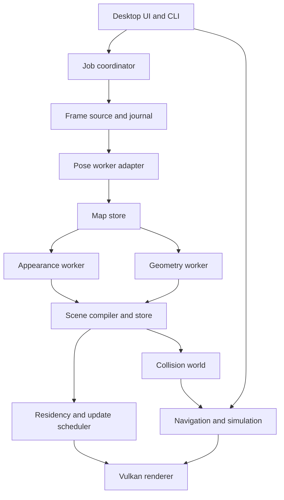
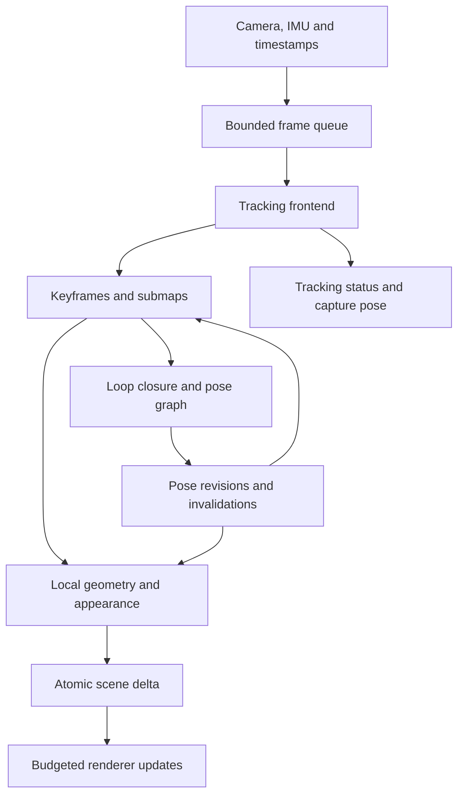

# World Explorer — implementation plan

**Research cutoff: 10 October 2026, UTC. Version 1.1; milestone scheduling revised 15 October 2026, Asia/Hong_Kong.**

User-approved [M1 development-exit decision](adr/012-m1-development-exit.md): available Linux hardware and hosted native CPU CI support M1; physical Windows/macOS viewer qualification moves to M4. The research cutoff and §3 acceptance targets are unchanged.

## 1. Vision and scope

Build a desktop application that converts a completed camera video into a persistent scene that the user can explore with a responsive, unrestricted fly camera. Add walking only where reconstructed geometry supports it. The initial product is an offline reconstruction application and a standalone C++/Vulkan viewer; its data and update contracts also support a future continuously changing map.

**Recommended path:** C++26-targeted application code using a tested C++20/23 feature subset; Vulkan 1.4-targeted rendering with a portability profile; COLMAP for poses; a separate gsplat worker for optimized appearance; and independently reconstructed, confidence-tagged geometry. Persist both Gaussian splats and triangle meshes. Use Brush as the qualification candidate for local non-CUDA splat training. Do not make a feed-forward foundation model, a NeRF renderer, or Gaussian SLAM a Phase 1 dependency.

Target users are developers, researchers, designers, and people documenting rooms, objects, buildings, and outdoor locations. Prioritize one room and object captures first, several connected rooms next, and bounded outdoor captures after that. A cityscape video is accepted as input, but city-scale completeness is a later capability, not an initial promise.

### Product assumptions and boundaries

- The initial scene is predominantly static. Moving people, screens, foliage, vehicles, mirrors, glass, water, textureless walls, and severe rolling shutter are explicitly difficult cases.
- Monocular video does not establish absolute scale from geometry alone. Store arbitrary scale unless a measured distance, calibrated depth/stereo, or another independently validated scale source is supplied.
- A free camera can travel anywhere. Reconstruction quality cannot be promised anywhere: unseen backsides and occluded rooms remain unknown. Display a coverage/confidence overlay and provide a return-to-capture-path command.
- Phase 1 assumes a commercially distributable product is desirable. This is a technical license screen, not a claim that every dependency or checkpoint has received a completed legal review.
- C++ applies to the application, viewer, storage, scheduling, and public contracts. Existing Python/CUDA and optional Rust reconstruction engines run as isolated workers. An all-C++ reconstruction implementation would materially change the schedule.
- No generative completion, dynamic 4D replay, multiplayer, VR, architectural certification, surveying guarantees, automatic physically correct relighting, or unrestricted city-scale mapping in v1.

These boundaries are design decisions and inferences, supported by the distinct geometry, appearance, and tracking responsibilities demonstrated in COLMAP, Open3D, 3DGS, and SLAM implementations [S01–S04, S28–S40].

### Evidence notation

| Mark | Meaning |
|---|---|
| **E** | Established method or capability supported by at least two independent source families; see the claim ledger in §6.8. |
| **R** | Promising research result; production robustness is not established here. |
| **D** | Our proposed engineering decision or inference, not an externally verified fact. |
| **T** | Proposed acceptance target, not a measured result. |
| **S** | Specific fact verified from one controlling source family only. A paper and its authors' repository count as one family. |
| **U** | Unverified, unavailable, or not reproduced. Do not treat it as a commitment. |

All architecture, thresholds, budgets, effort estimates, and recommendations below are **D/T** unless explicitly identified as external evidence. All exact versions, license statements, maintenance observations, and published benchmark values are **S** unless explicitly cross-validated. This report does **not** claim to have independently reproduced published experiments or compiled all three toolchains. Missing second-source validation is recorded rather than concealed.

## 2. Features and objectives

| Area | MUST — Phase 1 release | SHOULD — after the core is reliable | COULD — later |
|---|---|---|---|
| Capture/import | Completed MP4/MOV input through a controlled decoder; variable-frame-rate timestamps, rotation, color metadata; trim; blur/exposure/overlap diagnostics; immutable input identity; manual masks | Image sequences, camera calibration import, measured scale, gravity/floor alignment; guided capture checklist; automatic dynamic-region proposals with review | Live USB/network camera, synchronized IMU/depth, rig capture, mobile capture companion |
| Reconstruction | Keyframe selection; robust pose solve; disconnected-component reporting; trained splat appearance; sparse preview; resumable stages; explicit failure reasons; finite-value and resource checks | Dense MVS plus geometry proxy; textured mesh export; difficult-sequence matcher; masks; small/standard/high-quality presets | Foundation-model initialization; online SLAM; incremental Gaussian optimization; independently validated inverse rendering |
| Storage | Versioned scene schema; camera conventions; provenance; model/code/config hashes; chunk checksums; transactional publish; relocatable bundle; bounded loading | Spatial chunks and LOD; cache eviction; incremental revision log; scene crop; partial export | Remote scene delivery, georeferencing, collaborative changes |
| Rendering | Native Vulkan fly viewer; splats, mesh, and point preview; linear/HDR intermediate path; resize/HiDPI; capability report; bounded VRAM; diagnostics | GPU culling/sorting; LOD and streaming; mesh PBR assets; baked-appearance mode; calibrated frame capture | RT shadows/reflections, relightable splat materials, 3DGUT/3DGRT-compatible assets, HDR output |
| Navigation | Mouse look, WASD, ascend/descend, speed control, noclip, reset/bookmark, focus-loss release; identical conventions across platforms | Walk mode with conservative capsule collision, gravity, step/slope limits; explicit scale; safe recovery if collision disappears | Gamepad, path recording, accessibility presets, orbit/inspection tools |
| Tooling | CLI and GUI share job API; logs and stage timings; cancellation; reproducible build presets; platform CI; renderer validation; benchmark harness; license inventory | Headless rendering; golden scenes; fault injection; diagnostic archive excluding raw images by default | Remote worker orchestration and distributed reconstruction |

“MUST” reconstruction quality is certified first on the NVIDIA reference pipeline. Other platforms must open the same packages and expose their actual local-processing capability. They must not silently substitute a sparse cloud for a completed dense scene.

Capture guidance: translate around surfaces rather than only pan; maintain overlapping views; lock lens/focus/exposure where possible; avoid digital zoom and aggressive stabilization; revisit the starting area; capture doorways from both sides. These are operating recommendations, not guaranteed numeric capture rules.

## 3. Measurable success criteria

### 3.1 Reference hardware and workloads

Hardware below is a proposed test fixture, not hardware on which this report ran experiments.

| ID | Fixed qualification fixture | Purpose |
|---|---|---|
| **H_R** | Ryzen 9 7950X, 64 GiB RAM, RTX 4090 24 GiB, NVMe SSD; pinned Arch userspace/driver snapshot | Offline reconstruction and primary viewer |
| **H_V** | Ryzen 5 7600, 32 GiB RAM, RTX 3060 12 GiB, NVMe; Arch and Windows 11 | Mainstream viewer and reduced training preset |
| **H_A** | Ryzen 9 7950X, 64 GiB RAM, Radeon RX 7900 XTX 24 GiB; pinned Arch/Mesa | Native Vulkan portability; Brush qualification; HIP only if the exact ROCm/GPU tuple passes |
| **H_M** | Apple M3 Pro, 18-core GPU, 36 GiB unified memory; macOS 15 or newer supported release, exact OS build recorded | MoltenVK viewer and Brush qualification |

**W1:** 60 seconds of 1080p30 static-room video; approximately 120 retained keyframes at up to 1,600-pixel long edge; one lens; bounded 8 m × 8 m × 3 m room after scale calibration. **W2:** a textured object with a complete 360-degree capture, approximately 80 keyframes. **W3:** three connected rooms, 3–5 minutes, up to 600 keyframes. **W4:** bounded outdoor path, up to 1,000 keyframes, no expectation of reconstructing an entire city.

The release corpus is 20 independently captured, consented W1/W2 videos, stratified by phone/camera and texture level, plus public pose/geometry/rendering benchmarks. Maintain separate development, validation, and sealed release sets. Publish failure counts and exclusions. Select scenes before tuning; do not remove hard failures from the denominator.

### 3.2 Acceptance targets

| ID | Target **T** | Measurement and assumptions |
|---|---|---|
| **Q1: completion** | At least 18/20 eligible W1/W2 clips complete; at least 90% of selected training keyframes register in each passing clip | One documented recovery attempt allowed; record its cost. Preflight eligibility excludes cuts, pure rotation, and wholly dynamic scenes before reconstruction, using published rules. Also report outcomes for rejected clips. |
| **Q2: appearance** | Quality preset on the 7-scene Mip-NeRF 360 subset: aggregate PSNR ≥27.5 dB, SSIM ≥0.84, LPIPS ≤0.20; no scene loses >1 dB versus our pinned uncompressed trainer baseline | Same official image resolutions/split and fixed metric implementations; 30k-step quality evaluation, no Gaussian cap for this benchmark. These thresholds do not promise identical performance on all phone videos. |
| **Q3: video generalization** | On W1/W2, median per-scene held-out PSNR ≥25 dB, SSIM ≥0.80, LPIPS ≤0.25; report each scene | Hold out temporal blocks and an independently captured inspection path. A random split of adjacent video frames is insufficient. Estimate evaluation poses without using evaluation appearance for fitting or exposure optimization. Mark uncertain evaluation localization separately. |
| **Q4: poses** | Sim(3)-aligned monocular ATE RMSE ≤1% of GT path length and 1-second RPE median ≤2% translational distance / ≤1° rotational error on ≥80% of the selected sequences | Fixed TUM/EuRoC subset with valid image timestamps; TUM/EuRoC are pose tests, not substitutes for phone-video tests. One global alignment only. Report tracking failures and metric SE(3)-aligned errors separately when scale is observed. Exclude zero-length segments from normalized RPE by a fixed rule. |
| **Q5: geometry** | Indoors after independent scale alignment: median point-to-surface error ≤3 cm, 90th percentile ≤10 cm, F-score ≥0.80 at 5 cm | Measured or laser-scanned observed surfaces only; fixed sampling, visibility mask, and alignment. Report accuracy and completeness separately. Do not score hallucinated or unobserved surfaces as recovered geometry. Use DTU/ETH3D official metrics alongside this internal criterion. |
| **Q6: packing fidelity** | Packed render loses ≤0.2 dB PSNR and increases LPIPS by ≤0.01 relative to the same uncompressed scene; geometric quantization ≤1 mm within room chunks | Fixed 100-view path; compare renderer to itself before/after packing. Precision and SH order are metadata, never guessed from file size. |
| **P1: offline time** | W1 standard end-to-end median ≤30 minutes, p90 ≤45 minutes on H_R; first sparse preview ≤5 minutes median | Includes decode, poses, 7k-step appearance, low-resolution MVS/proxy, packing; excludes one-time environment/model installation. Report separately from the 30k-step Q2 quality preset. W3/W4 have separate measured curves, not a linear per-minute promise. |
| **P2: NVIDIA viewer** | At 1920×1080, ≥60 presented FPS, p95 frame interval ≤16.7 ms, p99 ≤25 ms on H_V for the certified scene | Up to 2 million resident degree-3 splats, ≤1 million contributing splats, bounded tile-reference list ≤8 million, or 2 million visible mesh triangles with ≤1 GiB textures. Measure a 120-second adversarial fly path after 30-second warmup; five runs; no training competing for GPU. Report vsync, present mode, resolution, LOD, overdraw and driver. |
| **P3: portable viewer** | Same H_A target after qualification; H_M ≥30 FPS, p95 ≤33.3 ms at 1920×1080 for ≤500k contributing splats and ≤4 million tile references | Keep screenshots and quality metrics for reduced LOD. Equal scene semantics, not identical budgets. Performance for Intel GPUs/older Macs remains U until tested. |
| **P4: memory** | H_V viewer ≤6 GiB device allocation and ≤4 GiB process RSS; H_R reconstruction ≤20 GiB device allocation and ≤48 GiB RSS | Separate CPU staging, GPU scratch, texture residency, and training optimizer state. On H_M, total application working set ≤10 GiB with no sustained swap; unified memory is not counted twice. Cap the W1 trainer at 2 million splats; reduce image resolution before retrying an OOM. |
| **P5: loading** | Certified ≤500 MiB package: first navigable coarse scene ≤2 s, full requested residency ≤8 s on H_V NVMe | Record cold process start/cold filesystem cache and warm-cache results separately; exclude extraction by using an unpacked indexed bundle. Shader cache misses are included in cold results. |
| **P6: updates** | Scene-update CPU enqueue ≤0.5 ms p95; streamed uploads add ≤2 ms GPU time per frame; no interactive GPU-idle waits | Measure concurrent chunk replacement/eviction and a revision replay at 10 updates/s. Defer work to meet budget; never block the camera on reconstruction. |
| **N1: controls** | Input-to-camera-state ≤1 frame; measured input-to-display p95 ≤50 ms at 60 Hz on H_V | Synthetic event timestamps plus high-speed-camera/photodiode check for release; prevent hidden render queues >2 frames. |
| **N2: walking** | No penetrations >2 cm or missed floors in 100 scripted paths through certified walkable regions; no tunneling at configured speed | Includes corners, slopes, stairs, thin walls, chunk boundaries, and scene replacement. Unknown geometry is blocked in walk mode. This validates software behavior, not building safety. |
| **E1: correctness** | ≥80% line and ≥70% branch coverage of first-party non-GPU core; ≥90% branch coverage of package/update validation; zero known sanitizer/validation errors | Exclude vendored code, generated bindings and platform boilerplate with reviewed exclusions. Track GPU behavior with image comparisons and synchronization tests instead of pretending coverage measures shaders. |
| **E2: delivery** | Cached PR CI ≤15 minutes critical path; clean native viewer build ≤30 minutes per 16-vCPU/32-GiB runner; nightly GPU suite ≤2 hours | External dependency cold-build time reported separately. Arch x86-64, Windows 11 x86-64, macOS Apple Silicon are release gates; Intel macOS is initially best effort. |
| **L1: future live** | Research gate: ≥15 Hz pose updates; ≤200 ms p95 capture-to-pose; ≤2 s p95 capture-to-preview; viewer stays ≥30 FPS on H_R | 720p RGB input, bounded active submap, 20-minute replay. Tracking, mapping, refinement and rendering rates are measured separately. This is not a Phase 1 promise. |

P2's initial 16.7 ms planning budget is: CPU simulation/submission 2.0 ms, GPU visibility/projection 1.5 ms, binning/sorting 2.5 ms, splat compositing 6.0 ms, mesh/UI/post 2.0 ms, and approximately 2.7 ms margin. CPU and GPU overlap, so these are profiling allocations rather than an instruction to add unrelated timers. Rebalance only from traces.

### 3.3 Benchmark protocol

For every result save dataset license/version, file hashes, selected frame IDs, camera calibration, train/validation/test split, git commits, checkpoint SHA-256, config, seed, precision, hardware, OS/driver/compiler/CUDA versions, warmup policy, peak memory definition, complete per-scene output and failures. Run stochastic training with three seeds for release comparisons and present median plus range. Use bootstrap intervals when claiming a quality improvement.

Pose localization of a held-out frame may use its image to determine the test camera, but it must not update the training map, splats, intrinsics, or per-image appearance. Prefer external GT poses for rigorous novelty tests. Report official benchmark evaluation separately from strict video holdouts; mixing the two silently invalidates the comparison.

Metrics require the exact LPIPS backbone and implementation, SSIM window, image color space, crop, mask, exposure policy, and resolution. Freeze them. The gsplat documentation explicitly reports an LPIPS implementation difference from the original 3DGS evaluation [S07]; an independent benchmark also highlights metric/resolution sensitivity [S09b].

For our Q2/Q3/Q6 gate, choose display-encoded RGB in [0,1], per-image PSNR followed by equal-weight per-scene means, Gaussian-window SSIM (11×11, sigma 1.5, data range 1, K1=0.01, K2=0.03), and TorchMetrics LPIPS with the AlexNet backbone and `normalize=True`. Lock metric-package and backbone hashes at M1. No fitted test-image exposure or color correction. Apply only a predetermined common valid-image crop/mask and report excluded area. Keep a separately labeled VGG LPIPS column when comparing papers that use VGG; never compare its numeric threshold directly to AlexNet. The current gsplat trainer exposes both backbones, so its default is not an adequate reproducibility specification [S81].

## 4. System architecture

### 4.1 Layers and processes



| Module | Owns | Must not own |
|---|---|---|
| `core` | IDs, time, math wrappers, result types, bounded task queues, logging | Vulkan, PyTorch, decoder or solver dependencies |
| `capture` | Decode, timestamps, intrinsics identity, image storage and preprocessing history | Map topology or rendering |
| `reconstruction_api` | Versioned requests/events, worker capabilities, frame/pose/map contracts | Concrete reconstruction frameworks |
| `reconstruction_adapters` | COLMAP, gsplat, Brush and optional model processes | Viewer GPU objects |
| `map_store` | Keyframes, tracks, poses, calibration revisions, submaps, observation provenance | Renderer-specific packing |
| `scene_compiler` | Validated mesh/splat chunks, LOD, bounds, confidence, collision inputs | UI state |
| `scene_store` | Atomic scene revisions, asset index, immutable snapshots and change journal | Vulkan handles |
| `render_core` / `render_vulkan` | Visibility, uploads, GPU residency, frame graph and GPU lifetime | Training tensors or direct map mutations |
| `navigation` | Fly camera and optional character controller | Pose estimation |
| `application` | Orchestration, user choices, progress/error presentation | Algorithms already owned by lower layers |

The viewer and `we_process` coordinator are native C++. Reconstruction runs outside the viewer process. A worker protocol handshake declares API version, backend version, supported sensor types, batch/streaming capability, device options, checkpoint rights, checkpoint semantics, and resource limits.

Use length-prefixed FlatBuffers messages over inherited local pipes or local-domain sockets; Windows uses named pipes. Send bulk artifacts by immutable file reference and hash first. Add shared-memory buffers only after profiling, and reference them by leases rather than raw addresses. A future remote transport uses the same messages and an explicit asset-transfer layer; it is not enabled automatically.

### 4.2 The four contracts that must exist now

| Contract | Phase 1 implementation | Future evolution without changing consumers | Required semantics now |
|---|---|---|---|
| **Frame source** | Seekable FFmpeg file source; image-sequence replay | USB/AVFoundation/Media Foundation/V4L2/network/rig sources | Capture ID, monotonic timestamp plus original PTS/time base, image lease, calibration ID, optional exposure/IMU/depth; explicit EOF, gap, reset and cancellation; `seek` optional, never presumed |
| **Pose estimator** | COLMAP adapter accumulates selected frames, runs batch solving, emits initial and corrected poses | DPVO/SLAM tracker emits provisional poses while loop closure/BA emits revisions | Stable frame/submap IDs, `submit`/`drain`/`finish`, tracking status, capability negotiation, nullable covariance, pose revision and invalidations; output is not append-only |
| **Map/scene store** | Persistent map snapshots plus final compiled scene | Mutable keyframe graph and locally refined submaps compile into scene deltas | Stable IDs, world epoch, transaction base revision, atomic commit, dependencies, deletes, submap transforms, snapshot/replay; geometry records the pose revision used to build it |
| **Renderer update path** | Initial snapshot is delivered through the same update queue as chunk replacements | Bounded asynchronous live chunk upload, replacement, deletion and transform updates | Budgeted enqueue; upload readiness; render-visible acknowledgement; snapshot resync after missed revisions; no reconstruction pointer or GPU allocation crosses the API |

Do not disguise batch COLMAP as a real-time tracker. `capabilities.streaming_tracking` is false. `finish()` means “no further observations for this run,” not “destroy the process.” Offline replay tests must inject delayed poses, repeated events, a loop-closure transform, deleted geometry and dropped update messages from the first milestone.

### 4.3 Public interface sketch

This sketch specifies API shape; domain types are defined in `core`/`reconstruction_api`, not by third-party frameworks. `result<T>` is an alias of `std::expected<T, error>`. No ABI stability is promised for these in-process C++ classes; serialized worker messages are the compatibility boundary.

```cpp
namespace world_explorer {

struct frame_packet {
    frame_id id;
    capture_id capture;
    std::chrono::nanoseconds capture_time;
    source_timestamp original_timestamp;
    calibration_id calibration;
    image_lease pixels;
    std::optional<depth_lease> measured_depth;
    std::vector<imu_sample> imu_samples;
};

using source_event = std::variant<frame_packet, frame_gap, source_reset, source_end>;
using pose_event = std::variant<pose_estimate, pose_revision, tracking_change,
                                submap_created, map_alignment, estimator_finished>;

class frame_source {
public:
    virtual ~frame_source() = default;
    virtual source_capabilities capabilities() const noexcept = 0;
    virtual result<source_event> read_next(std::stop_token stop) = 0;
    virtual result<void> seek(source_timestamp target) = 0;
};

class pose_estimator {
public:
    virtual ~pose_estimator() = default;
    virtual estimator_capabilities capabilities() const noexcept = 0;
    virtual result<void> start(const pose_estimator_config& config) = 0;
    virtual result<observation_ticket> submit(frame_observation& observation) = 0;
    virtual result<std::vector<pose_event>> drain_events(event_budget budget) = 0;
    virtual result<void> finish() = 0;
    virtual void request_stop() noexcept = 0;
};

class map_store {
public:
    virtual ~map_store() = default;
    virtual result<map_revision_id> commit(map_transaction transaction) = 0;
    virtual map_snapshot acquire_snapshot() const = 0;
};

class scene_store {
public:
    virtual ~scene_store() = default;
    virtual result<scene_revision_id> commit(scene_transaction transaction) = 0;
    virtual scene_snapshot acquire_snapshot() const = 0;
    virtual result<scene_delta_batch> changes_since(scene_revision_id revision,
                                                   byte_budget budget) const = 0;
};

class renderer_update_sink {
public:
    virtual ~renderer_update_sink() = default;
    virtual result<update_ticket> enqueue(scene_delta_batch& batch) = 0;
    virtual update_progress query_progress(update_ticket ticket) const = 0;
    virtual void set_residency_budget(residency_budget budget) = 0;
};

} // namespace world_explorer
```

`submit` and `enqueue` move leases/data from the referenced argument only on success; failure leaves it unchanged, and full queues return `WOULD_BLOCK`. Retrying with the same operation ID is idempotent. Serialize calls to an estimator except its thread-safe `request_stop`; document the update sink as multi-producer/single-consumer. `read_next` runs on a source thread and cancellation interrupts decoder I/O; it is never called by the render thread. Unsupported seeking returns `UNSUPPORTED_OPERATION`. Queue capacity is advertised.

`pose_estimate` contains camera-to-submap SE(3), timestamp, tracking state and optional uncertainty. `map_alignment` carries a revisioned Sim(3) between submap and world. `pose_revision` identifies affected keyframes and invalidates derived depth/geometry when required. A confidence score is not labeled covariance unless the backend actually estimates calibrated covariance.

### 4.4 Data model and artifact formats

**Coordinate contract:** right-handed world, +Y up, metres only when scale is observed; otherwise `scale_status=ARBITRARY`. Camera optical coordinates use +X right, +Y down, +Z forward. Store `world_from_camera`, quaternion order `w,x,y,z`, row/column and serialization conventions explicitly. Use integer pixel centers in the canonical camera model. Convert every backend at its adapter, including the half-pixel principal-point convention documented by COLMAP [S02]. Test projection/unprojection and camera-pose round trips with asymmetric fixtures.

CPU world/submap transforms use doubles. GPU vertices and splat means use floats relative to a nearby chunk origin; rebase the camera origin for large scenes. Store geographic coordinates separately from local rendering coordinates. Sim(3) scale changes update geometry, navigation dimensions and metadata atomically. For splats, transform covariance as `s² R Σ Rᵀ`; evaluate SH using the view direction expressed in the splat's local frame. A nonrigid pose correction requires rebuilding/refitting affected content, not just moving its bounding box.

| Artifact | Proposed format and rules |
|---|---|
| Job request / manifest | Human-readable JSON; schema version, source hash, preset, limits, stage graph, environment lock, licenses and output locations |
| Captured observations | Journal with stable IDs and timestamps; selected images PNG/JPEG plus explicit decode/color/crop metadata; optional original video reference. No requirement to decompress the entire video into RAM |
| SfM intermediate | Native COLMAP SQLite database and binary/text model as worker-owned artifacts; adapt through pycolmap, not ad hoc SQL writes. Preserve rigs/frames where present |
| Canonical poses/calibration | FlatBuffers tables with double transforms, camera model and coefficients, crop/resize transform, scale/gravity provenance; JSON export for inspection |
| Depth/normal/confidence | Chunked little-endian float arrays plus metadata and zstd; camera-space z-depth versus ray distance explicitly distinguished; invalid mask separate from zero |
| Training checkpoint | Backend-native, trusted local artifact plus full optimizer/RNG state when supported. A PLY export is not a resumable optimizer checkpoint |
| Scene bundle | Unpacked `.wexplore/` directory with `manifest.json`, binary index, independently compressed asset chunks, preview and provenance; optional archive for transport, unpacked before use |
| Mesh | glTF 2.0/GLB for interchange; runtime compiled vertex/index/material chunks; collision geometry separately simplified. Baked capture texture uses an unlit material; it is not mislabeled intrinsic albedo |
| Splats | PLY import/export only for interchange. Canonical runtime format stores decoded mean, covariance/orientation-scale, opacity, explicit SH basis/order, color domain, bounds, LOD and confidence |
| Collision cache | Canonical triangle data plus build parameters; optional Jolt cooked cache keyed by Jolt version, CPU/ABI and source hash. Rebuild incompatible caches |
| Scene updates | `scene_id`, `epoch`, `base_revision`, `new_revision`, operation ID, and asset references; create/replace/delete chunks, update anchors/materials/bounds, invalidate geometry |

A minimal manifest must include:

```json
{
  "schema_version": 1,
  "scene_id": "generated-uuid",
  "epoch": 0,
  "revision": 1,
  "coordinates": {
    "handedness": "right",
    "world_up": "+y",
    "camera_axes": "+x_right,+y_down,+z_forward",
    "pose_convention": "world_from_camera",
    "quaternion_order": "wxyz",
    "pixel_centers": "integer",
    "scale_status": "ARBITRARY"
  },
  "appearance": {"representation": "gaussian_3d", "lighting": "captured"},
  "geometry": {"collision_status": "UNAVAILABLE"},
  "index": "scene_index.bin",
  "provenance": "provenance.json"
}
```

The compiler must normalize common PLY encodings: log-scales, opacity logits, quaternion ordering and SH channel layouts. Keep a schema-specific importer per exporter/version. Reject ambiguous encodings instead of producing plausible but incorrect images. Record training camera, antialiasing and color-response conventions so renderer parity can be tested.

Publish by writing immutable assets, validating hashes and bounds, flushing them, and atomically replacing the manifest pointer. The previous valid revision survives interruption. The index contains byte sizes before allocation; reject oversized dimensions/counts, unsafe paths, decompression bombs, NaNs and invalid covariance. Schema minor changes are additive; incompatible major versions require an explicit converter.

### 4.5 Threading, GPU work and resource lifetime

- Main/UI thread pumps native events and updates application state. A simulation owner applies camera/character inputs. One render owner controls Vulkan object creation, command submission and swapchain state.
- Bounded I/O/decode workers feed a bounded CPU task pool. Cap CPU reconstruction threads to avoid OpenMP/BLAS/decoder oversubscription. Use `std::jthread`, stop tokens and condition variables first; no lock-free queue or custom coroutine runtime without a measured need.
- Reconstruction workers use their own GPU contexts. Default Phase 1 scheduling pauses heavy training during interactive viewing on a shared GPU. Do not assume Vulkan queue priorities control CUDA scheduling.
- Use one graphics/compute queue initially, plus a transfer queue only where it improves measured overlap. On MoltenVK, multiple Vulkan queues need not yield useful parallel Metal execution. Keep a correct single-queue path.
- Upload through a bounded staging ring. Use synchronization2 barriers and timeline-based retirement; use binary semaphores for swapchain acquire/present. If a portability device lacks a selected convenience feature, choose the tested fallback profile before creating pipelines.
- Retain immutable CPU snapshots and old GPU allocations until every referencing submission completes. Chunk IDs have generation counters; a freed slot cannot be mistaken for a new chunk. Reclaim by completed timeline values, not elapsed frame count.
- A delta transitions through accepted → assets available → uploaded → render-visible → retired. A large transaction can upload over many frames, but becomes visible atomically. If its base revision is missing, request a snapshot; do not apply it out of order.
- Under pressure, evict far/fine LOD, reduce SH order or resolution, then use coarse mesh/point preview. Preserve collision residency around the walking capsule independently of visual residency.

### 4.6 Rendering implementation

**Phase 1 frame graph:** upload/readiness → visible-chunk selection → splat projection/binning/sorting and mesh visibility → opaque mesh pass → splat compositing → tone mapping → UI → present. Keep resources, access modes and barriers in a small explicit pass graph. Do not build a multi-API engine abstraction; Vulkan is the renderer API, while content and render passes remain modular.

Implement two splat paths:

1. **Vertical-slice path:** compute visibility plus depth-key generation, GPU radix sort, instanced quads and back-to-front alpha blending. No geometry shader, mesh shader, subgroup-size assumption or ray tracing. CPU sorting is a small-scene diagnostic fallback only. The NVIDIA Vulkan sample independently demonstrates raster and sorting approaches [S45–S46].
2. **Quality/performance path:** 16×16 screen tiles; project anisotropic covariance; count tile overlaps; exclusive scan; emit `(tile_id, depth_key, splat_id)` references; stable radix sort; build tile ranges; front-to-back compute compositing with transmittance termination. Match the pinned trainer's projection, filtering and clamping in parity tests. Shared-memory scans and 32-bit key components form the portable baseline; subgroup variants are optional specializations. Budget tile-reference count, not merely splat count.

Global center sorting and tile center sorting are both approximations for extended/intersecting Gaussians. Test popping on rotating/close-up paths. Do not call arbitrary alpha order physically exact. Cap pathological footprints with an explicit degraded-quality indicator; improve LOD/splitting before silently dropping large contributors. Weighted blended OIT is not the default replacement for ordered 3DGS compositing.

The portable reference shader projects covariance with `covariance_screen = projection_jacobian * rotation_view * covariance_world * transpose(rotation_view) * transpose(projection_jacobian) + filter_variance * identity`. Invert the resulting 2×2 matrix to evaluate the elliptical Gaussian. With the pinned renderer's clamp/threshold constants, each sample contributes `alpha = opacity * exp(-0.5 * quadratic_distance)`; front-to-back compositing accumulates `color += transmittance * alpha * splat_color` and updates `transmittance *= 1 - alpha`. Termination, minimum determinant, near-plane behavior and footprint filtering must match the pinned recipe; arbitrary changes can invalidate parity. Validate positive finite depths before creating sortable keys. Reject list overflow before emission; split work or select coarser LOD rather than wrapping a counter. These formulas describe the intended reference implementation, with filtering details verified against the selected trainer [S06, S36].

Use explicit Vulkan zero-to-one clip depth and tested viewport-Y handling. Do not reuse an OpenGL projection matrix without conversion. An infinite-far reversed-Z mesh projection is optional; splat depth ordering uses consistent positive camera depth independently of depth-buffer encoding.

Mesh rasterization uses conventional vertex/index draws, material batches and mipmapped textures. Render captured textures unlit by default. Reserve material fields for GGX metallic-roughness, normal/emissive maps, lights, environment probes and shadow resources; these apply immediately to authored meshes, not automatically to captured splat radiance.

Keep a linear HDR output path, but respect the trainer's appearance domain. For legacy scenes optimized in display-encoded RGB, composite in the declared capture domain for parity and convert before final scene composition; do not silently reinterpret learned values as linear radiance. A later linear-training preset must be separately calibrated and benchmarked.

For hybrid rendering, opaque authored meshes provide a depth buffer that clips splat contributions behind them. The proxy mesh is normally invisible and must not occlude its own splat appearance. Capture-mesh fallback is selected by region/LOD ownership to avoid double-rendering the same surface. A single expected splat depth is not generally sufficient for exact transparent interleaving; complicated transparent assets are out of v1 scope.

Later RT passes may build triangle BLAS/TLAS, then add Gaussian intersection/ray-query paths after feature and memory qualification. Secondary rays do not recover unknown BRDFs or remove baked illumination. 3DGUT/3DGRT and the current Vulkan sample provide research/implementation references, not proof of physically correct relighting of arbitrary input videos [S44–S46b].

### 4.7 Memory and scaling model

A degree-3 Gaussian has 48 SH coefficients. A simple full-float payload with mean (12 B), scale (12 B), quaternion (16 B), opacity (4 B), and SH (192 B) is **236 B per splat before padding**: approximately 225 MiB/million. A proposed mixed-precision runtime payload is approximately 128 B/splat, or 122 MiB/million. These are arithmetic estimates, not measured allocation totals.

Training adds gradients, optimizer moments, saved activations and scratch buffers, so it cannot be budgeted from the viewer payload. Sorting also matters: 8 million 12-byte references require about 92 MiB per buffer, or about 183 MiB for a ping-pong pair before alignment, scans and tile ranges. Quads or wide splats can be fill-rate limited even when geometry fits comfortably.

Start with 50k–200k-splat independently replaceable chunks, then tune by traces. Spatially subdivide, retain parent LOD, select by projected error/importance, and globally order visible contributions where needed; independently drawing alpha-blended chunks in arbitrary order is incorrect. Do not claim a random subset of splats is a quality-preserving LOD. Build coarse levels by measured merge/refit or simplification, with transition/opacity validation.

For W3/W4, partition by view-graph connectivity and spatial support, train overlapping submaps, and assign deterministic ownership to duplicated border content. Preserve shared anchors and run alignment/loop checks. Out-of-core observations and hierarchical residency are required before raising input limits; a larger GPU is not the scaling architecture.

### 4.8 Errors, recovery and navigation

Use typed errors: `BAD_INPUT`, `DECODE_FAILED`, `INSUFFICIENT_PARALLAX`, `POSE_DISCONNECTED`, `TRACKING_LOST`, `GPU_OUT_OF_MEMORY`, `DEVICE_LOST`, `LICENSE_NOT_ENABLED`, `CORRUPT_ASSET`, `STALE_REVISION`, `WOULD_BLOCK`, `CANCELLED`. User-visible errors state the failed stage, retained artifacts and next useful action. An OOM may trigger one logged lower-budget retry; never silently publish the degraded result as the requested quality preset.

Use RAII and move-only owners for Vulkan objects, files, mapped buffers and worker processes. Return `expected` for routine failures; catch exceptions at task/process boundaries and convert to errors. Do not disable exceptions globally while depending on libraries that use them. Invariant violations fail loudly in debug; untrusted input is validated in all builds. A worker crash cannot corrupt the committed scene. Device loss closes/recreates the renderer as a controlled operation while preserving CPU scene state.

Fly mode: relative mouse look; W/S along view direction, A/D along camera right, Space/Ctrl along world up/down; Shift accelerates; wheel scales speed; configurable bindings; roll locked by default; Escape releases capture. Initial speed is proportional to robust scene extent until metric scale is set. Store bookmarks in scene coordinates, including epoch.

Walk mode: Jolt kinematic capsule, fixed 120 Hz simulation with a capped catch-up budget, swept collision, sliding, maximum 45° slope and 0.30 m step as initial defaults; 1.7 m eye height and 0.25 m radius only after scale/floor confirmation. Build collision from supported geometry, not an opacity threshold alone. Preserve unknown/free/occupied labels; unknown is blocked. On invalidated collision, stop and offer fly mode or relocate to a verified safe position. Do not continue using stale collision while displaying a corrected map.

### 4.9 Decision records

| ADR | Options and criteria | Choice and rationale | Trade-off and revisit trigger |
|---|---|---|---|
| **01 Representation** | Mesh, splats, NeRF, hybrid; appearance, collision, editability, lighting, GPU cost | Hybrid package: splats for appearance; separate mesh/confidence for collision and fallback | Two reconstruction products and alignment cost. Revisit if a surface-aware method satisfies Q2/Q5/P1 under acceptable licensing |
| **02 Poses** | Incremental/global SfM; neural feed-forward; SLAM; registration reliability and recoverability before raw throughput | COLMAP incremental for W1/W2; try integrated global mapper for >300 keyframes with calibrated intrinsics, fall back by quality gates | Batch cost and low-texture failures. Revisit when a cleared model improves completion by ≥10 percentage points without worsening Q4 or exceeding memory limits |
| **03 Appearance fitting** | gsplat, original 3DGS, Brush, NeRF; reproducibility, licenses, performance, control | Pinned gsplat worker on NVIDIA; Brush portable candidate | Python/CUDA package complexity; two optimizers may differ. Promote Brush only after Q3/Q6 and crash/resume qualification |
| **04 Geometry** | MVS+TSDF, Poisson, splat-depth extraction, surface-aware GS | MVS consistency-filtered depths → confidence-aware TSDF → mesh; Poisson only as explicit inspected alternative | Sparse/reflective surfaces stay unknown. Revisit after a learned/surface-aware method passes geometric GT tests and license review |
| **05 Worker boundary** | Link solvers into viewer; FFI; subprocesses | Versioned subprocess protocol and immutable artifacts isolate CUDA/compiler/library churn | Serialization and copies. Add shared memory only if measured copies exceed 5% of stage time or L1 latency budget |
| **06 Platform policy** | Require NVIDIA everywhere; port trainer to Vulkan; independent backends | Portable viewer, certified NVIDIA worker, qualified Brush, optional HIP worker | No immediate equal training speed. Revisit per exact hardware results, never per API branding |
| **07 Language** | Require all C++26; C++23 only; tested subset with C++26 target | C++26 development/CI mode, stable shared subset, explicit C++23-compatible release fallback where needed | Cannot use reflection/contracts everywhere. Revisit feature-by-feature after all release compilers and libraries pass probes |
| **08 GPU baseline** | Bindless/mesh/RT mandatory; conservative raster+compute | Vulkan 1.4 target; capability-driven portable raster/compute path | More binding batches and fallback shaders. Enable optional features only when they improve a trace-backed metric |
| **09 Storage/updates** | Single PLY; in-place mutable buffer; immutable chunks and revisions | Versioned hybrid chunks with transactional updates and deferred GPU reclamation | Index/schema overhead. Revisit chunk sizing after W3/W4 traces; retain revision semantics |
| **10 Live path** | Adopt Gaussian SLAM now; replay-only batches forever; separate tracking/mapping | Offline contracts now; future tracking frontend plus revisioned submaps and slower appearance refinement | More lifecycle design in Phase 1. Revisit backend choice at live milestone using L1/Q4 and checkpoint licensing |
| **11 Build/dependencies** | Arch rolling packages only; multiple package managers; pinned manifests | CMake/Ninja, vcpkg baseline, isolated worker locks/images, exact CI compiler versions | Periodic upgrade work. Revisit only for a demonstrated packaging limitation |
| **12 Unknown content** | Fill holes automatically; suppress uncertainty; preserve unknown regions | Explicit coverage and confidence, bounded walking, unrestricted fly with diagnostics | Less visually complete results. Revisit generative completion only as separately labeled content |

## 5. Workflows

### 5.1 Offline: video to explorable scene

Every stage consumes immutable inputs, writes to a temporary stage directory, validates outputs, and atomically records completion. Cache keys include input hashes, calibration, masks, configuration, backend commit and checkpoint. A changed pose solution invalidates dependent depths, splats and collision; a changed display preference does not. Cancellation completes or discards the current transaction. An interrupted trainer resumes only from a compatible optimizer checkpoint, never from a PLY falsely labeled as a checkpoint.

| Step | Concrete implementation and initial policy **D** | Output / acceptance or recovery |
|---|---|---|
| 1. Inspect | Probe video streams with FFmpeg; honor variable PTS, edit/rotation metadata, color primaries and range. Ignore audio by default. Hash the original; inspect available storage and worker capabilities | `input_manifest.json`; explicit unsupported-codec, corrupt-stream and storage errors; no silent timestamp synthesis |
| 2. Select and preprocess | Decode sequentially; consider 2–4 frames/s initially, select for blur, exposure change, tracked-feature displacement and spatial coverage. Aim at 120 W1 keyframes; retain extra candidates for recovery. Detect cuts, lens changes and repeated frames | Selected original frame IDs and timestamps; exact crop/resize/undistortion transforms; rejected-frame reasons. Thresholds are tuned on development data, then frozen |
| 3. Calibrate and match | Preserve one intrinsic group per physical lens/zoom segment. Start with COLMAP SIFT and sequential matching, initial neighbor window 10; add up to 5 retrieval loop candidates per keyframe. Verify geometrically. Use exhaustive matching for small objects when affordable | Native COLMAP database plus canonical observations; calibrations have versioned priors. Optionally use ALIKED+LightGlue only after its model/dependency audit and matching evaluation |
| 4. Solve poses | Incremental mapper for W1/W2. For larger sets with credible intrinsics, attempt integrated global mapping; evaluate registration count, reprojection residual distributions, disconnected components and plausible baseline/parallax | Pose/track snapshot and diagnostics. Reject a numerically low reprojection error if the reconstruction is degenerate. One recovery adds candidate frames/matches or switches mapper. Do not align unrelated components without evidence |
| 5. Establish frame | Choose a local origin; estimate gravity only from supplied IMU or user-approved floor alignment. Apply measured distance/depth for metric scale. Keep uncertainty and source | Versioned `world_from_submap`; otherwise scale remains `arbitrary`, and metric walking is unavailable |
| 6. Make dense inputs | Undistort selected images using the solved cameras. Preserve photometric transform and valid-pixel masks. Export consistent camera/image IDs for all workers | All workers use the same calibrated image domain. Check round-trip reprojection on a small fixture before running expensive work |
| 7a. Fit appearance | gsplat, pinned release/commit and config, degree-3 SH; standard 7k iterations, quality 30k; W1 cap 2 million splats. Use sparse SfM initialization. Log densification, pruning, losses, time and peak memory | Native training checkpoint plus canonical splats and held-out results. OOM recovery reduces resolution/cap and records the changed preset; no silent downgrade |
| 7b. Recover geometry | COLMAP PatchMatch MVS on a qualified CUDA/HIP device; filter cross-view consistency. Integrate camera-space depth with explicit confidence into Open3D-backed sparse TSDF blocks; extract mesh, remove small unsupported components, simplify within an error bound | Mesh, normals, confidence and coverage/free-space masks. Start room voxels at 2 cm and truncation at 8 cm; these are tunable metric defaults, not universal guarantees. Missing depth remains unknown |
| 8. Build collision / mesh fallback | Cook a separate simplified collision mesh; derive walkable cells only from supported surfaces and observed free space. For mesh-only rendering, atlas and project/blend calibrated source colors, checking seams and coverage | Collision references its geometry and pose revision. Captured-color texture is tagged `baked_appearance`, not inferred PBR albedo. Hole filling is opt-in and flagged |
| 9. Compile scene | Validate finite values, bounds, IDs and scale; partition assets into spatial chunks; build quality-ranked LOD, pack attributes and compress; generate thumbnails and navigation bookmarks | Transactional scene bundle; uncompressed-to-packed Q6 comparison; memory estimates and capability requirements in manifest |
| 10. Review and open | Load coarse scene first, stream toward camera, expose reconstruction coverage and disconnected components; show a source-camera comparison | Fly is enabled as soon as a valid coarse representation exists. Walk appears only when metric scale, collision and supported walkable coverage are ready |

Steps 7a and 7b may run concurrently on different GPUs. On one GPU the coordinator normally serializes them and prioritizes the interactive viewer. If geometry fails, deliver the valid appearance scene with an explicit geometry failure and disabled walk mode; do not claim the complete hybrid preset passed P1/Q5.

Dense-depth fusion rules matter: distinguish axial camera `z` from ray range; propagate units; reject occlusion inconsistencies; retain observation counts and surface uncertainty; do not integrate a monocular model's “metric” estimate as measured truth. Depth-model priors can initialize or regularize a separately evaluated experimental recipe. They do not replace the scale/calibration gate.

For arbitrary-scale inputs, choose fusion resolution relative to the robust scene extent (initially extent/512), store that unit explicitly, and make no centimetre-accuracy claim. Metric voxel defaults and Q5 apply only after scale calibration. Walking remains gated independently of whether a visually useful unscaled mesh can be extracted.

The first release packages versioned backend recipes rather than relying on COLMAP GUI defaults or changing upstream CLI defaults. The recipe test invokes the pinned binaries' help/version output and runs a tiny end-to-end fixture. Database-changing calibration or mapper experiments operate on copied inputs [S01–S03].

### 5.2 Future live/incremental path



Recommended first experiment: replay recorded RGB through a DPVO/DP-SLAM adapter on NVIDIA, with explicit checkpoint/dependency clearance before distribution. Its MIT code is attractive, but separate pretrained-weight rights remain **U** in this review [S29]. If that gate fails, use a negotiated commercial ORB-SLAM3 license, or GPL-compatible distribution; do not assume process separation removes GPL obligations [S28]. A calibrated stereo/IMU product would justify evaluating Basalt instead [S31]. This is a future backend decision, not a dependency required for Phase 1.

1. Run tracking independently of appearance optimization. Preserve every accepted timestamp and explicit gap; drop stale non-keyframes under load, never silently relabel them as contiguous. Relocalization and tracking loss are states visible to the UI.
2. Start a new submap after loss, large uncertainty, calibration change, or resource threshold. Keep a bounded active optimization window. Retain compact descriptors/keyframe records for later relocalization and loop closure; archive images according to retention policy.
3. Maintain a fast sparse/low-detail preview and a slower refined appearance layer. Initial live mapping should use bounded per-submap fitting, not continual optimization of an unlimited global tensor.
4. Loop closure publishes a transaction. A rigid or similarity correction transforms a complete submap and its associated splats/mesh/collision consistently. A non-rigid pose correction marks affected products stale and triggers re-integration or rebuilding from saved keyframes/depth. Until the rebuilt revision is ready, render the old internally consistent snapshot with a stale-status marker; disable unsafe collision.
5. Publish coarse replacements first, then refined chunks. Repeated events are idempotent; out-of-order deltas with a wrong base revision request resynchronization. Renderer backpressure controls publication rate, not pose tracking.
6. Keep the user's spectator camera distinct from the physical capture camera. A loop correction must not teleport the spectator unexpectedly: preserve the selected reference frame or explicitly interpolate a requested follow-camera correction.
7. On a single GPU, cap live mapping work and memory; measure tracking latency separately from render FPS. A second worker GPU is optional. Do not promise that 60 FPS viewing plus full-rate training fits the offline reference budget.

Phase 1 must already ship a synthetic delta/replay fixture demonstrating add, replace, delete, world-epoch reset, pose correction and collision invalidation. This is the inexpensive proof that the offline implementation has not hard-coded final-only scenes.

### 5.3 Developer workflow

The following commands define the intended developer interface; they are a specification for the new repository, not commands claimed to exist today.

```sh
cmake --preset linux-clang-debug
cmake --build --preset linux-clang-debug
ctest --preset linux-clang-debug
cmake --workflow --preset linux-release-verify
we_process doctor --json diagnostics.json
we_process reconstruct --input room.mp4 --recipe standard_nvidia --output room.wexplore
we_viewer room.wexplore
we_bench render --scene fixtures/room.wexplore --path fixtures/fly_path.json --output results
we_bench pipeline --corpus fixtures/release_corpus.json --recipe standard_nvidia --output results
```

Use pinned compiler images on Linux and recorded Visual Studio/Xcode toolchains on their native runners. Arch remains the primary interactive development platform, but rolling distribution upgrades do not silently update release dependencies. A native viewer does not require Python, CUDA or a training environment. Download/install a selected worker through an explicit user action with its version, disk cost and license manifest visible.

PRs run formatting, dependency boundary checks, unit/serialization tests, a tiny synthetic scene renderer test where a GPU is available, and package schema validation. Nightly jobs run reference GPU traces, scene reload/fault tests and representative reconstruction. Release jobs run the sealed corpus, three-seed quality comparisons, SBOM/license checks, package signing and platform installation/uninstallation tests. GPU timings from virtual/software renderers are correctness checks only, not performance evidence.

## 6. Technology stack and research assessment

### 6.1 Representation decision against spectator-mode requirements

This comparison is an engineering assessment **D**, informed by the independently developed geometry, splat and renderer systems in [S36–S46]. “Free fly” requires both camera freedom and an honest statement of where scene information exists.

| Criterion | Textured triangle mesh | 3D Gaussian splats | Recommended hybrid | NeRF / implicit field |
|---|---|---|---|---|
| Captured appearance | Strong with accurate surfaces and good texture coverage; seams/holes expose reconstruction errors | Often compelling captured appearance; can represent thin/translucent-looking details and view dependence, but floaters and wrong extrapolation remain | Splat appearance with separately controlled geometry; cross-layer agreement must be checked | Strong view synthesis within observed coverage; extrapolation remains unobserved |
| Unrestricted viewpoints | Mesh reveals backsides/holes directly; can render two-sided deliberately | Looking behind/inside the capture can expose stretched splats, sparse regions and sorting artifacts | Same coverage limits; use diagnostic overlay and mesh fallback where valid | Empty/incorrect density can appear outside observed rays; still not recovered hidden geometry |
| Collision | Direct acceleration structure and character-controller input after mesh validation | No reliable solid boundary from opacity alone | Independent confidence-limited collision mesh | Isosurface/depth extraction and validation required |
| Lighting | Standard PBR and RT fit naturally; photographs still contain baked illumination | Standard SH color is outgoing appearance, not material/lighting separation | Tag captured layers as baked; support PBR authored/validated mesh layers | Ordinary radiance fields also bake illumination; relighting needs different supervision/model |
| Editing | Mature topology/UV/material/transform tools | Crop/delete/transform feasible; semantic edits/material changes need additional structure | Geometry edit invalidates or transforms related appearance regions | Editing typically requires specialized field operations or retraining |
| Memory | Often compact after simplification/texture compression; texture resolution dominates | Millions of primitives plus SH, visibility and sorting scratch; LOD needed | Higher total asset complexity; stream layers independently | Compact weights can coexist with large grids/caches; per-ray working cost matters |
| Vulkan cost | Standard indexed rasterization, depth test, culling; portable | Projection, expansion/binning, sorting and transparency; high screen coverage dominates | Both pass types plus explicit composition policy | Compute ray marching or baking; many samples/ML evaluations can dominate |
| Main failure | Geometry holes/wrong topology and texture seams | Floaters, popping/sorting, overdraw, absent solid surfaces | Two pipelines, alignment and revision management | Integration complexity, rendering cost, geometry ambiguity |
| Product role | Collision, mesh export, low-end/fallback and future PBR | Primary visual reconstruction | **Default package** | Research comparison; do not build a second default renderer in v1 |

Surface-aware 2DGS, SuGaR and MILo try to narrow the geometry/appearance gap [S37–S39]. They are evaluation candidates rather than automatic replacements: extraction quality, view synthesis, license terms, runtime cost and robustness must all pass this project's gates. An Apache-licensed implementation of 2DGS within gsplat is a different code artifact from the restricted original 2DGS repository; audit the selected implementation independently [S06, S37].

### 6.2 Selected production components

License entries are **S**, based on the controlling sources listed; they do not clear transitive dependencies, patents, models or datasets. “Last evidence” means the latest dated release/news actually verified here, not an invented latest-commit date. **U** means the exact last activity or support tuple was not established. All observations were checked for this report on 2026-10-10.

| Component | Selection and reason **D** | License / product eligibility **S** | Maturity, hardware and last evidence | Fallback |
|---|---|---|---|---|
| Build/dependencies | CMake + Ninja; vcpkg manifest with immutable baseline and feature selection | CMake BSD-3; Ninja Apache-2; vcpkg MIT; verify packaged port licenses independently | Established; CMake docs expose C++26 standard selection; exact installed versions pinned at M1 [S61, S62] | Manual CMake package adapters for a missing port, not an unpinned second graph |
| Window/input | SDL3; native high-DPI and relative mouse input | zlib; product-usable [S64] | Established family; native Linux/Windows/macOS; exact SDL3 release date U | Thin native surface adapter if a platform defect blocks release |
| UI | Dear ImGui for technical desktop UI | MIT [S65] | Established immediate-mode UI; exact last activity U | Keep application commands UI-independent |
| Vulkan plumbing | Vulkan headers/loader; volk; Vulkan Memory Allocator | Apache-2 for Vulkan headers/loader; MIT for volk/VMA [S49, S66] | Mature ecosystem; exact GPU features are runtime-query results | Explicit allocation path for diagnostics; no alternate production graphics API |
| Apple graphics | MoltenVK translating Vulkan to Metal | Apache-2 [S47, S48] | v1.4.2 dated 2026-07-20; portability subset, not native Vulkan | Lower LOD/resolution; fail with precise missing-capability diagnostic |
| Shaders | GLSL → SPIR-V ahead of time using pinned Khronos glslang/SPIRV-Tools; shared generated layout definitions | Multiple permissive notices; release SBOM must cover the selected tools [S49] | Mature workflow; compiler version/target environment frozen | Consider Slang later only for demonstrated maintenance/RT benefit |
| Capture | FFmpeg libavformat/libavcodec/libswscale, minimal shared build | LGPL-2.1-or-later baseline; selected GPL/nonfree flags can change rights [S63] | Mature; CPU decode baseline; hardware decode optional | Image sequence; OS decoder adapter later |
| Pose/map | COLMAP 4.2.1 worker, incremental and integrated global mapping | BSD-3 core; optional/transitive components must be audited [S01–S04] | Mature; CPU sparse path, CUDA accelerated paths; HIP MVS added 4.2.0; 4.2.1 dated 2026-09-29 | Incremental/global cross-fallback; reviewable manual calibration; graceful component failure |
| Learned matching | Optional ALIKED + LightGlue, integrated through a pinned adapter | ALIKED BSD-3; LightGlue Apache-2 code/weights; do not substitute SuperPoint without separate terms [S05] | Research-derived and widely integrated; COLMAP 4.0 added ONNX support; exact model performance here U | SIFT with geometric verification |
| Appearance | gsplat worker; export canonical representation rather than runtime training tensors | Apache-2 code; default SfM initialization needs no downloaded learned checkpoint [S06] | Established research/software toolkit; Python/PyTorch/CUDA; latest verified tag 1.5.3, exact tag date U | Qualified Brush worker |
| Portable appearance | Brush 0.3.0 qualification track | Apache-2 [S10, S11] | Rust/Burn/WebGPU; repo supports macOS/Linux/Windows and multiple GPU vendors; exact device performance U; release date year U | Import a scene from a qualified worker; optional explicitly configured remote worker |
| Geometry | Consistent MVS depth + Open3D TSDF/extraction worker | Open3D MIT; selected third-party modules audited [S40] | Established fusion; Open3D 0.20 announcement 2026-09-24; CPU path available; no automatic “Intel support” guarantee for every operation | Imported RGB-D or validated mesh; retain splat scene with walk disabled |
| Mesh processing | meshoptimizer, xatlas, fastgltf | MIT [S67, S68] | Established focused libraries; CPU preprocessing; exact latest activity U | Simple unsimplified mesh, per-view texture projection, restricted glTF subset |
| Collision | Jolt Physics character controller and static triangle shapes | MIT [S69] | Mature native library; CPU; exact current release U | Fly-only; never approximate missing floors as safe collision |
| Math/data | GLM for graphics; explicit geometry wrappers; FlatBuffers; zstd | GLM MIT-family; FlatBuffers Apache-2; zstd BSD-3 option [S70, S71] | Mature; no shared C++ ABI across workers | Uncompressed chunks and versioned JSON diagnostic export |
| Tests/profiling | Catch2, Google Benchmark, Tracy; Vulkan validation; RenderDoc/Nsight/Xcode GPU tools as platform allows | Catch2 BSL-1; Benchmark Apache-2; Tracy BSD-3; external profiler terms separately [S72] | Established; GPU debugging tools are development dependencies | CPU traces and timestamp-query captures where a debugger is unavailable |

Do not bundle OpenMVS as an uncomplicated proprietary fallback: its core is AGPL-3 and its dependency inventory includes additional restrictions, including research-only `ibfs` [S41]. Likewise, COLMAP's BSD core license is not permission to ignore CGAL or any other dependency pulled into a binary. Select only needed features, inspect the resulting dependency graph/SBOM, and use a separately cleared or commercial component if necessary [S03, S73]. These license conclusions are single-source legal screens, not legal opinions.

### 6.3 Pose, feed-forward reconstruction and depth survey

Classification: **E** established practice; **R** research/qualification candidate. Benchmark values belong in §6.5; absence of a matched public benchmark is not evidence of poor quality. License status describes possible non-research use, not this project's legal approval. Each row's version, license, hardware and maintenance details are **S**; unspecified latest activity is **U**.

| Candidate / status | Function and project decision | Code / weights and non-research use | Hardware, maturity, dated evidence and benchmark status |
|---|---|---|---|
| COLMAP + integrated GLOMAP — E | Default geometrically verified SfM; global for large calibrated sets, incremental recovery | BSD-3 core; GLOMAP now integrated, audit binary dependencies | CPU/CUDA, selected HIP MVS; 4.2.1 2026-09-29. GLOMAP paper 2024-07, now older foundation. No transferable video-minute timing established [S01–S04] |
| ORB-SLAM3 — E | Mature visual/visual-inertial multi-map option for future live | GPL-3; commercial use is possible under GPL obligations or negotiated separate license; incompatible with an assumed closed bundle without review | CPU; camera/IMU calibration critical. Last announced version in README: 1.0, 2021-12-22; exact last commit U. Re-evaluate on our device/corpus [S28] |
| DPVO / DP-SLAM — R→qualification | Recommended first learned live-tracking experiment; do not couple viewer to it | MIT code; pretrained-weight rights not separately established: U | CUDA; repo tested Ubuntu/CUDA combinations, not a macOS promise. Papers 2023/2024; exact latest commit U. Our L1/Q4 results U [S29] |
| DROID-SLAM — R | Strong learned optimization baseline, heavier dependency footprint; compare offline/live replay | BSD-3 core; checkpoint/dependency clearance still required | Repo specifies ≥11 GB GPU for demonstrations and up to 24 GB for some benchmarks; training larger. Foundational 2021; latest activity U [S30] |
| Basalt — E/R by use | Candidate if synchronized calibrated stereo/IMU is selected | BSD-3 core with separate dependency terms | CPU visual-inertial system; do not infer equal support for arbitrary monocular phone video. Canonical GitLab/mirror available; latest dated change U [S31] |
| MASt3R-SLAM — R | Dense monocular SLAM without assumed calibration; useful comparator, excluded from commercial default | CC-BY-NC-SA-4.0 code/model family | CUDA; author tests RTX 4090; paper reports 15 FPS, not a portable latency guarantee. December 2024 / CVPR 2025 [S32] |
| CUT3R — R | Persistent recurrent state for incremental 3D perception; promising live initialization | CC-BY-NC-SA-4.0 | GPU/PyTorch research stack; 2025 release/paper; exact last activity, bounded-memory behavior and our latency U [S33] |
| VGGT — R | Camera/point/depth initialization and recovery experiment; do not replace verified SfM blindly | Custom commercial-use code terms/AUP; original weights differ from separately offered `VGGT-1B-Commercial` checkpoint | PyTorch/GPU, memory grows with views; commercial checkpoint announced 2025-07-29; memory work noted 2026-05-15. License is not plain MIT/Apache [S12, S13] |
| VGGT-Ω — R | 2026 long-sequence/feed-forward candidate; research-only comparison | FAIR Noncommercial Research License; excluded from non-research bundle | A100 memory measurements in §6.5; released 2026-05-18, new reference checkpoint/training release 2026-09-18. Do not mix older disputed checkpoint results with new ones [S14–S16] |
| Pi3 / Pi3X — R | Permutation-equivariant reconstruction; Pi3X conditions on optional priors | BSD-3 code, but **both model weights CC-BY-NC-4.0**; not a cleared commercial inference path | GPU research models; Pi3 2025, Pi3X release 2025-12-28. Exact recent commit and matched performance U [S17] |
| DUSt3R / MASt3R — R, foundational | Pairwise geometry/matching baselines; demonstrate useful learned initialization but not default product engines | CC-BY-NC-SA-4.0 repositories/checkpoint family | CUDA research stacks; 2024 foundations, subsequent SfM work; exact latest activity U [S23, S24] |
| Fast3R — R | Multi-view feed-forward scaling comparator | FAIR noncommercial terms; commercial outputs/use restricted; no default shipping | GPU; CVPR 2025. “1000+ images” is a paper capability, not a consumer-GPU budget or latency promise [S25] |
| DepthSplat — R | Feed-forward depth/splat reconstruction comparator; useful for fast initialization, separate from the default per-scene optimizer | MIT code; full checkpoint/dependency rights require separate clearance, including selected depth backbone | CVPR 2025; update 2025-03-27; CUDA research stack. No matched W1 performance established here [S26] |
| VGG-T3 — R | Test-time-training approach to scalable offline reconstruction | NVIDIA OneWay Noncommercial terms for project/model; mixed submodule licenses | CVPR 2026; GPU research workflow. No matched hardware/runtime reproduced here [S27] |
| Depth Anything 3 — R→qualification | Optional consistent depth/camera priors; exact checkpoint matters | Apache-2 code. Small/Base and specified Mono/Metric-Large variants Apache-2; Large/Giant/Nested families listed NC. Pin full checkpoint ID/hash | GPU models from ~0.08B to ~1.40B parameters; v1.1 weights noted by repo, exact date U. “Metric” remains an estimator, not ground truth [S18] |
| Apple Depth Pro — R | Metric-depth prior comparator, especially boundaries; not the geometry authority | Custom Apple code license; exact pretrained-weight distribution scope must be cleared separately (U) | October 2024 paper; 2.25 MP / 0.3 s claim lacks a precisely identified GPU in retrieved abstract. CPU/Mac product speed U [S19, S20] |
| Depth Anything V2 — R, foundational | Smaller relative-depth fallback for diagnostic proposals | Small checkpoint Apache-2; Base/Large/Giant CC-BY-NC-4.0; code terms separate | June 2024 foundation, news 2025-01-22; GPU/CPU implementation possibilities do not establish real-time device performance [S21] |
| Video Depth Anything — R | Temporal-depth proposal for future video/live geometry regularization | Small model Apache-2; Base/Large NC; verify selected metric/streaming checkpoint independently | CVPR 2025; streaming metric news 2025-09-12. Consistent depth alone does not supply drift-free poses or map lifecycle [S22] |

Feed-forward models can substantially change initialization cost or recovery behavior, but none is accepted here on a headline image-count or FPS alone. Required experiments are Q1/Q4/Q5 on unseen captures, peak-memory curves versus frame count, loop/camera-intrinsic failure cases, and exact checkpoint rights. Geometry and poses must still enter the same canonical map contract.

### 6.4 Scene representations, extraction and online mapping survey

| Candidate / status | Role and decision | License / non-research screen **S** | Maturity, hardware, last evidence and benchmark availability **S/U** |
|---|---|---|---|
| Original 3DGS — E method | Reference appearance model; do not copy restricted source into our renderer | Original INRIA implementation permits research/evaluation, requires separate commercial consent | SIGGRAPH 2023 foundation; CUDA reference. Extensive follow-on evidence supports method, not unrestricted code use [S36] |
| gsplat — E implementation baseline | Default optimizer; compare degree/order, densification and anti-aliasing configurations explicitly | Apache-2 | CUDA/PyTorch; latest verified tag 1.5.3; main includes later 2026 work not necessarily in the tag. Reproducible numbers in §6.5 [S06–S08] |
| Brush — qualification | Portable trainer taking existing camera poses; does not replace SfM | Apache-2 | Rust/WebGPU; 0.3.0 verified, release year U. Independent benchmark exists, but hardware comparability needs investigation [S09–S11] |
| NeRF / Nerfacto / instant-NGP — E methods | Research comparison and possible baking pipeline; defer native neural-field runtime | Nerfstudio Apache-2 core; instant-NGP custom NVIDIA source terms; selected dependencies/weights need separate review | CUDA-oriented tooling; foundational 2022–2023 systems, latest exact activity U. No comparable native Vulkan product FPS established [S42, S43] |
| Radiant Foam — R | 2025 ray-traced volumetric/radiance-field alternative; compare artifacts and cost before considering a new asset type | Apache-2 code; checkpoint/submodule rights separate | Linux, CUDA 12.x, compute capability ≥7.0 in maintainer instructions. Repo warns about high memory and triangulation retries; exact last activity and matched product FPS U. Provides `benchmark.py`, but is not a portable Vulkan implementation [S80] |
| 2DGS — R/established research | Oriented surface disks plus depth regularization/TSDF; evaluate geometry alternative | Original repository inherits restricted INRIA license; gsplat implementation separately Apache-2 | SIGGRAPH 2024; CUDA training. gsplat publishes separate 2DGS measurements; Q5 and quality trade-offs still needed [S06, S07, S37] |
| SuGaR — R | Surface-aligned Gaussian-to-mesh extraction candidate | Restricted upstream-derived licensing; no default commercial bundle | CVPR 2024; GPU research pipeline; current last activity and matched product benchmarks U [S38] |
| MILo — R | Mesh-in-the-loop reconstruction, directly relevant to hybrid quality | Restricted/mixed research dependencies; exact distributable subset not cleared | SIGGRAPH Asia 2025; GPU differentiable extraction; benchmark transplant to our inputs U [S39] |
| Hierarchical 3DGS — R | Large-scene hierarchy/LOD reference, not a ready universal streaming layer | Original research code/license family; commercial clearance required | SIGGRAPH 2024 foundation; GPU training/rendering. Our chunk protocol can accommodate independently implemented hierarchical assets [S74] |
| 3DGUT / 3DGRT — R | More general projection and Gaussian ray tracing; future rendering experiment | 3DGRUT repository Apache-2; CUDA/OptiX SDK terms separate | NVIDIA stack; v2.0 June 2026. Supports research directions including nonlinear cameras/secondary rays; does not automatically recover relightable materials [S44] |
| NVIDIA Vulkan Gaussian sample — implementation reference | Demonstrates Vulkan raster/compute/RT approaches and later hybrid materials | Apache-2; audit copied code and submodules | Windows/Linux target, Vulkan 1.4; 2026.2.9 release observed September 2026. Mac portability not established; no product FPS inferred [S45, S46] |
| Open3D TSDF / meshing — E | Default fusion/extraction toolkit around explicitly valid depths | MIT core; third-party list must be reviewed | CPU and selected GPU paths; 0.20 announced 2026-09-24. New GPU features do not imply all operations run identically on every vendor [S40] |
| OpenMVS — E toolkit | Alternative MVS/texturing comparator, excluded from default bundle pending rights | AGPL-3 plus separately restricted components; a process boundary is not clearance | Mature CPU/GPU toolkit; exact last release date U. No reproducible W1 timing retrieved [S41] |
| MonoGS — R | Demonstrates monocular Gaussian SLAM, useful lifecycle/failure comparator | Research/noncommercial upstream terms | CVPR 2024; speed-optimized branch reports up to 10 FPS on one TUM sequence with RTX 4090/i9-12900K. Not a blanket main-branch/live claim [S34] |
| SplaTAM — R | RGB-D tracking/mapping with Gaussian appearance; useful if depth sensor selected | BSD-3 core, but original rasterizer/dependencies have separate restrictions | CVPR 2024; CUDA/PyTorch; **RGB-D**, not evidence of arbitrary monocular reconstruction. Exact latest activity U [S35] |
| MASt3R-SLAM / CUT3R — R | Complementary learned online pose/state directions | Noncommercial families; see §6.3 | 2024–2025; neither eliminates the need for bounded storage, scene revisions and asynchronous rendering [S32, S33] |

The strongest current research direction for this product is a better pose/depth initializer plus a geometry-aware appearance optimizer. The lowest-risk initial implementation remains modular SfM + splats + independently validated geometry. That is an inference **D**, not a claim that it wins every current benchmark.

### 6.5 Published benchmark evidence and limits

All numbers below are **S: author/maintainer-reported**, not independently reproduced in this report. They are included only with the retrieved experimental context. Different rows are not a controlled head-to-head comparison.

| Source and recipe | Reported result | Reproducibility and limitation |
|---|---|---|
| gsplat evaluation; 7 Mip-NeRF 360 scenes, TITAN RTX, 7k steps | PSNR 27.21, SSIM 0.831, LPIPS 0.202; 4.3 GB; 5m35s | Official `examples/benchmarks/basic.sh`, commit `6acdce4`; dataset/resolution and LPIPS implementation must match. This is training, not full video→scene time [S07] |
| Same gsplat recipe, 30k steps, 1 GPU | 28.95 / 0.870 / 0.135; 5.7 GB; 35m49s | Same table. Original INRIA comparator: 28.95 / 0.870 / 0.138, 9.0 GB, 37m13s. LPIPS implementations differ; do not claim exact metric parity [S07] |
| AMD gsplat fork 1.5.3b2, MI300X, 7 scenes, 30k steps | 29.15 / 0.87 / 0.12; 6.31 GB; 872 s | AMD documentation dated 2026-07-14. Useful independent evidence that a supported HIP stack can train; not a benchmark for RX 7900 XTX, Windows, or Mac [S08] |
| nvs-bench 17-scene aggregate | gsplat: 25.60 / 0.7861 / 0.3091, 11m4s, 2.16 GB; Brush: 27.30 / 0.8488 / 0.2492, 15m31s, 4.67 GB | Independent benchmark family, different recipes/data. Exact hardware was not established in retrieved material (**U**), so use it to identify an experiment, not rank our deployment choices [S09] |
| VGGT-Ω repo, balanced 512 mode, 624×416 inputs, single A100 | 50 frames: 9.66 GB; 100: 13.37 GB; 200: 20.82 GB; 500: 43.15 GB | Maintainer memory table for a full forward pass. Fix checkpoint/version; it shows why sequence length requires an explicit budget, not a throughput guarantee [S15] |
| MASt3R-SLAM paper/project | 15 FPS reported; repository says experiments use RTX 4090 | Author result; tracking/mapping workload and timing scope must be reproduced before comparison with L1 [S32] |
| MonoGS speed branch | Up to 10 FPS, TUM `fr3/office`, RTX 4090 + i9-12900K | Specific branch/sequence, not all scenes or a default release promise [S34] |
| Depth Pro abstract | 2.25-megapixel output in 0.3 s on a “standard GPU” | GPU model/settings not specified in the retrieved abstract; insufficient for a reproducible hardware target (**U**) [S19] |

Before selecting a faster implementation, run the same input cameras, masks, resolution, SH order, densification budget, training steps, exposure policy, metrics and device. Report output size and rendering speed as well as fitting speed. Keep official published recipes intact in a separate reproduction suite; matching our fixed budget is a different experiment.

### 6.6 C++26: actual support and shipping policy

Verified stable-release observations (**S**, not compiled here): GCC 16.2 was released 2026-08-07; LLVM/Clang 23.1.3 appears as the latest official release dated 2026-10-06; Microsoft's current documentation identifies MSVC Build Tools 14.51 as GA and the STL changelog distinguishes later preview work. Apple Clang is a separate distribution: Apple's support table contains Xcode 26.4-specific entries. Upstream Clang support must not be projected onto an installed Xcode toolchain [S51–S59].

Compiler language support, standard-library support and deployment OS requirements are three separate gates. Status pages also contain future-release rows. A listed GCC 17/Clang 24 feature is not a released GCC 16/Clang 23 capability.

| Feature / mode | GCC status source | Clang / Apple status source | MSVC status source | Project policy **D** |
|---|---|---|---|---|
| C++26 language mode | `-std=c++26`, experimental support since GCC 14 | `-std=c++2c`; partial support; use the spelling accepted by configured toolchain | `/std:c++latest` enables evolving features, not a complete C++26 guarantee | Development preset targets 26 with `CXX_STANDARD_REQUIRED=ON`; a separately named C++23-compatible release preset is allowed where probes fail |
| C++20 core: concepts, spans, ranges, `jthread`, `stop_token`, designated initialization | Mature in current toolchain; library probes still required | Mature current upstream; check chosen libc++/Apple deployment | Current compiler/STL support, exact configured tuple tested | Use these as the shared foundation; keep runtime interfaces simple |
| C++23 `std::expected` | Check installed libstdc++ and `__cpp_lib_expected` | Check libc++ and Apple availability rather than language flag alone | Current STL supports it; probe exact toolset | Use basic value/error API after configure test; avoid newer monadic overloads unless all release tuples pass |
| C++26 user-generated `static_assert` message | GCC 14 listed | Clang 17 listed | Exact feature support not independently established here: **U** | Use literal-message `static_assert` |
| C++26 pack indexing | GCC 15 listed | Clang 19 listed; Apple table has its own Xcode gate | Exact shipping support in retrieved matrix: **U** | Use `std::tuple`, `std::get`, `index_sequence` |
| Reflection | GCC 16 experimental, additional `-freflection` | Status lists no complete support | Verified shipping support: **U** | Avoid; generate schemas/layout bindings or use explicit traits |
| Contracts | GCC 16 experimental support listed | No complete support listed | Verified shipping support: **U** | Avoid; `assert` for programmer invariants, checked `expected` results for external failures |
| `#embed` | GCC 15 listed | Status lists no support | Verified shipping support: **U** | Generate asset byte arrays at build time or load versioned files |
| C++26 `std::execution`, `std::simd`, `std::inplace_vector` | Per-library partial/evolving status | Per-library matrix differs from compiler | Per-library preview/release differences | No verified common floor: avoid for shared production code; bounded task scheduler, explicit SIMD kernels when measured, reserved vectors/fixed arrays |
| Named modules | Implementation/build/dependency differences remain relevant | Apple and upstream integration differ | MSVC implementation differs | Headers and conventional translation units; revisit when dependencies and incremental-build measurements justify it |

Every required feature gets a CMake `try_compile` test and a compile/runtime fixture on all release toolchains. Test `__cpp_lib_expected >= 202202L` for the basic API; do not infer library availability from `__cplusplus`. Run debug/release, static/shared builds as applicable, and ABI-sensitive serialization checks. CMake's standard “decay” is disabled so a requested standard cannot silently become an older one [S61].

Keep CUDA compilation inside the worker environment with a CUDA-supported host compiler. The newest Arch GCC may be too new for the selected CUDA release; do not force the native viewer's C++26 compiler into every third-party CUDA build. The process boundary deliberately avoids that coupling.

### 6.7 Vulkan and platform capability policy

The retrieved Khronos specification is Vulkan **1.4.365, dated 2026-10-02** (**S**) [S49]. Target the Vulkan 1.4 API and pin headers, validation layers, shader compiler and a tested SDK/loader package at build time. The exact SDK bundle corresponding to that header revision was not verified (**U**); do not invent an SDK version. API version, driver support, optional feature bits, limits and extension availability are separate facts [S49, S50].

| Capability | Version/extension status **S** | Required behavior **D** | Portable fallback / verification |
|---|---|---|---|
| Instance/device versions | Query `vkEnumerateInstanceVersion` and physical-device `apiVersion` separately | Request the supported API profile; log all decisions | 1.4 is preferred; allow a tested lower API version with required extensions/features rather than reject a capable portability device by version number |
| Surface/presentation | Platform surface extensions + `VK_KHR_swapchain` | Graphics+compute queue, color presentation and resize handling | Select formats/present modes from queried lists; support FIFO; no fixed queue-family assumptions |
| Dynamic rendering / synchronization 2 | Core 1.3; KHR extensions on applicable lower versions | Baseline renderer profile after feature query | If missing required features, report unsupported device; M1 targets supported modern devices, not every Vulkan 1.0 GPU |
| Timeline semaphores | Core 1.2 / KHR extension | GPU retirement and upload scheduling | Check feature; keep binary semaphores for acquire/present. A serialized diagnostic path is not the performance-certified renderer |
| Storage buffers / 32-bit integer atomics / compute | Query limits and features for actual shaders | Conservative splat path; bounded buffers and workgroups | No assumption of FP64, float atomics, subgroup width 32, or large shared memory |
| Descriptor indexing / bindless | Core 1.2 feature family, individually optional capabilities/limits | Optional large-scene path | Baseline uses bounded descriptor sets and batches; do not require unlimited sampled images or update-after-bind |
| Buffer device address | Core 1.2 feature; MoltenVK device constraints apply | Optional optimization only | Conventional indexed storage buffers |
| Mesh/task shaders | `VK_EXT_mesh_shader`, optional | Optional expansion/culling experiment | Instanced quads or compute; not a baseline Mac capability |
| RT pipeline / ray query | KHR acceleration-structure, ray-tracing-pipeline/ray-query and dependencies, optional | Future mesh shadows/reflections after query and qualification | Raster/PBR environment lighting and screen-space effects; no Mac RT promise from MoltenVK version alone |
| FP16/storage precision | Separate arithmetic/storage features and format support | Optional packed/decode path after Q6 | FP32 decode/compute baseline; storage quantization does not require FP16 arithmetic |
| Memory budget / timestamps | Extensions/features/valid timestamp bits vary | Use reported budgets when available; maintain own allocation accounting | Conservative user/device cap; CPU wall-time plus supported GPU queries |
| Portability enumeration/subset | `VK_KHR_portability_enumeration`, `VK_KHR_portability_subset` | Set enumeration flag when extension is used; enable device subset extension when advertised | Query portability features/limits and adapt shaders/resources. Do not treat portability as complete native Vulkan conformance |
| SPIR-V | Vulkan/SPIR-V version compatibility is specified by Khronos | Compile against each tested target environment and validate offline | Use conservative shader variants; do not emit a newer SPIR-V module merely because the build machine supports it |

MoltenVK 1.4.2 translates Vulkan to Metal and advertises an almost-complete subset with device-dependent limits [S47, S48]. The runtime guide supports the selected conservative raster/compute direction, but its extension list does not establish baseline support for KHR ray tracing or EXT mesh shaders. Test real Apple hardware; a loader successfully creating an instance is insufficient.

| Platform/device | Phase 1 local reconstruction | Native viewer policy | Failure/degradation path |
|---|---|---|---|
| Arch + NVIDIA | Certified COLMAP CUDA + gsplat; MVS/proxy; isolated pinned worker environment | Native Vulkan 1.4 profile; P2 on H_V | Smaller recipe after explicit OOM notice; CPU sparse recovery |
| Arch + AMD | CPU sparse COLMAP; Brush qualification. COLMAP HIP MVS and AMD gsplat fork only for individually qualified ROCm/GPU tuples | Native Vulkan, same file format; P3 on H_A | Brush/CPU stages or explicitly configured external worker; MI300X results do not certify consumer Radeon |
| Arch + Intel | CPU sparse COLMAP; Brush candidate | Native Vulkan if required feature/limit profile passes | Reduced LOD/resolution; full pipeline performance U |
| Windows + NVIDIA | Native worker package where qualified; optional WSL2 worker via same protocol if necessary | Native Win32 Vulkan viewer; never require WSL for rendering | Keep WSL filesystem transfers explicit; validate native/WSL outputs against canonical schema |
| Windows + AMD/Intel | CPU poses; Brush qualification; do not presume Linux HIP recipes work here | Native Vulkan profile and device qualification | Import processed package or explicit external worker |
| macOS Apple Silicon | CPU poses; Brush can be qualified for local splat fitting. No CUDA. Default dense MVS/collision parity is not promised | MoltenVK, portable raster/compute; H_M smaller residency/sort budget | Scene from qualified worker or imported valid depth/mesh; splat-only local output keeps walk disabled if geometry unavailable |

Remote processing is a separately enabled transport with explicit endpoint, authentication, cost and retention policy. It must never be the silent response to a missing GPU. A Mac can remain a complete viewer even when a particular local reconstruction recipe is unavailable.

### 6.8 Cross-validation ledger

The user requirement for two independent sources is applied to broad technical conclusions below. Exact license terms and release versions usually have one authoritative owner; those facts remain explicitly **S**, rather than being padded with a second page from the same organization. Many 2025–2026 research results have no independent reproduction retrieved here and remain **R/S**. All measured product claims remain **U** until the proposed gates run.

| Claim / decision input | Independent source families | Status and limit |
|---|---|---|
| Explicit camera geometry plus optimized appearance is a practical offline decomposition | COLMAP [S01–S04]; nerfstudio/gsplat [S06, S07]; independent benchmark [S09b] | **E** for decomposition; chosen budgets and robustness are **D/T** |
| Gaussian appearance has renderer/memory costs that require sorting/culling/budget control | gsplat [S06, S07]; NVIDIA Vulkan renderer [S45, S46] | **E**; exact cost on our scenes **U** |
| Geometry/collision and captured radiance are different products | Open3D fusion [S40]; Gaussian representations/extraction [S36–S39]; Jolt [S69] | **E** for distinct responsibilities; hybrid product design **D** |
| Geometry-aware splat/mesh hybrids are an active research direction | 2DGS authors [S37]; SuGaR/MILo authors [S38, S39]; NVIDIA hybrid renderer [S45] | **R**, at least two independent groups; production superiority **U** |
| Non-NVIDIA Gaussian fitting is feasible on supported stacks | AMD gsplat measurements [S08]; independently developed Brush [S10] | **E** for existence; universal GPU/OS support explicitly not established |
| Foundation models can estimate multi-view geometry/poses/depth | Meta VGGT family [S12–S16]; Pi3 [S17]; ByteDance DA3 [S18] | **R**, independent methods; metric accuracy and failure rates on W1–W4 **U** |
| Incremental mapping needs pose correction/relocalization, not append-only frames | ORB-SLAM3 [S28]; DP-SLAM [S29]; Basalt [S31] | **E**; revision API details **D** |
| Full C++26 cannot be assumed across all shipping compiler/library pairs | GCC [S51, S52]; LLVM [S54, S55]; Microsoft [S57, S58]; Apple [S59] | **E** from independent vendors; individual support cells **S/U**; not a compiled conformance report |
| Vulkan version alone does not guarantee optional capabilities or Mac equivalence | Khronos specification/guide [S49, S50]; actual MoltenVK implementation [S47, S48]; NVIDIA sample [S45] | Specification and MoltenVK share Khronos provenance: not fully independent. **S** for portability details; sample is a separate implementation example, not proof of Mac support |
| Metrics are sensitive to recipe, image scale and LPIPS implementation | gsplat [S07]; CVISS benchmark [S09b]; NerfBaselines [S75] | **E**; published cross-table rankings must not be treated as controlled comparisons |
| Latest license/checkpoint rights and version/activity of each candidate | Exact controlling repository/model card/release entry in bibliography | **S** throughout; unknown weights and unavailable last-commit dates explicitly **U** |

## 7. Repository, dependency rules and style guide

### 7.1 Layout

| Path | Responsibility |
|---|---|
| `CMakeLists.txt`, `CMakePresets.json`, `vcpkg.json`, `vcpkg-configuration.json` | Explicit targets/presets, immutable dependency baseline and selected features |
| `cmake/toolchains/`, `cmake/feature_probes/` | Compiler/deployment profiles and required language/library/Vulkan feature probes |
| `include/world_explorer/core/`, `src/core/` | IDs, errors, time, geometry, leases, bounded queues; minimal dependencies |
| `include/world_explorer/capture/`, `src/capture/` | Sources, decode adapters, frame journal and preprocessing |
| `include/world_explorer/reconstruction_api/`, `schemas/worker/` | Public reconstruction contracts and generated wire protocol |
| `src/reconstruction_adapters/`, `workers/colmap/`, `workers/gsplat/`, `workers/brush/` | Subprocess integration, pinned recipes, environment locks and conformance fixtures |
| `src/map_store/`, `schemas/map/` | Map transactions, keyframe graph, calibration/pose revisions and provenance |
| `src/scene_compiler/`, `src/scene_store/`, `schemas/scene/` | Scene generation, validation, chunks, indexes, replay and migration tools |
| `src/render_core/`, `src/render_vulkan/`, `shaders/` | Frame graph, rendering, residency, Vulkan RAII wrappers, portable/optional shader variants |
| `src/navigation/`, `src/collision/` | Fly camera, supported walk regions and Jolt integration |
| `apps/we_viewer/`, `apps/we_process/`, `apps/we_bench/` | Thin desktop, batch and benchmark entry points |
| `tests/unit/`, `tests/integration/`, `tests/gpu/`, `tests/fuzz/` | Layered tests, portable image fixtures, replay and parser/update fuzz targets |
| `benchmarks/`, `fixtures/manifests/` | Fixed workloads, camera paths, dataset-rights metadata and result schemas; large data stored externally by hash |
| `tools/`, `packaging/`, `ci/` | Asset generation, reproducible packaging, signed release definitions and runners |
| `docs/adr/`, `docs/protocols/`, `docs/capture/`, `third_party/notices/` | Decision records, protocol/convention docs, user guidance and complete notices/SBOM |

Each module is a separate CMake target. Public headers expose project-owned types. `core` depends on no higher layer; `capture` and `reconstruction_api` depend on `core`; adapters depend on the API; `map_store` depends on the API/core; `scene_compiler` reads maps and emits scene schemas; `render_core` reads scene schemas; only `render_vulkan` sees Vulkan/VMA; `collision` sees scene geometry and Jolt; `application` composes them. Neither `render_core` nor navigation includes a COLMAP/PyTorch header. Workers are not linked into the viewer. Enforce dependency edges using CMake target links and an include-boundary CI check.

### 7.2 Short style guide and enforcement

- **Names:** `snake_case` for functions, variables, namespaces, types, files and template type parameters. `CAPITAL_SNAKE_CASE` for constants, enumerators and unavoidable macros. Example: `scene_revision_id`, `enqueue_scene_update`, `MAX_RESIDENT_CHUNKS`. Preserve external API names only at adapter boundaries.
- **Clarity:** `world_from_camera`, `capture_time_ns`, `resident_splat_count`, `upload_completion_value`; avoid `tmp`, `data2` and directionless transform names. Use typed IDs, units, extents and views; distinguish element counts from byte sizes.
- **Ownership:** values and RAII by default; `unique_ptr` for exclusive dynamic ownership; `shared_ptr` only for deliberate immutable snapshots/leases. Borrow through references/spans with explicit lifetimes. No owning raw pointers, manual `new/delete`, or hidden global singleton state.
- **Performance:** no unbounded allocation, disk I/O, training work or device-idle calls on the interactive frame path. Reserve/reuse scratch buffers; record high-water marks. Optimize from traces; do not sacrifice deterministic resource limits for speculative cleverness.
- **Comments:** concise explanations of intent, invariants, numerical choices and synchronization hazards. Do not narrate obvious statements. Document coordinate and wire contracts once at their definitions.
- **Errors:** `expected` for recoverable failures; assertions for internal invariants; exceptions caught at third-party/process boundaries. No throwing destructors. Return structured errors with stage, code, action and diagnostic ID.
- **Headers/API:** explicit includes, self-contained headers, namespace-scoped APIs, no `using namespace` in headers. Prefer narrow interfaces; keep templates away from the stable serialized boundary.

Pin one clang-format/clang-tidy release for formatting/linting across platforms. An initial `.clang-format` profile is LLVM base, four-space indentation, 100-column limit, attached braces, explicit pointer/reference alignment, and deterministic include sorting. clang-format does not enforce identifier spelling; clang-tidy does [S60].

```yaml
# Representative .clang-tidy fragment; validate keys against the pinned release.
Checks: >-
  -*,clang-analyzer-*,bugprone-*,performance-*,portability-*,
  modernize-use-override,modernize-use-nullptr,readability-identifier-naming
CheckOptions:
  readability-identifier-naming.NamespaceCase: lower_case
  readability-identifier-naming.ClassCase: lower_case
  readability-identifier-naming.StructCase: lower_case
  readability-identifier-naming.EnumCase: lower_case
  readability-identifier-naming.TypedefCase: lower_case
  readability-identifier-naming.TypeAliasCase: lower_case
  readability-identifier-naming.FunctionCase: lower_case
  readability-identifier-naming.MethodCase: lower_case
  readability-identifier-naming.VariableCase: lower_case
  readability-identifier-naming.ParameterCase: lower_case
  readability-identifier-naming.MemberCase: lower_case
  readability-identifier-naming.TemplateParameterCase: lower_case
  readability-identifier-naming.ConstantCase: UPPER_CASE
  readability-identifier-naming.EnumConstantCase: UPPER_CASE
  readability-identifier-naming.MacroDefinitionCase: UPPER_CASE
```

Lint first-party headers/sources only; explicit documented suppression at unavoidable external callbacks/generated bindings. Turn warnings into errors for first-party code, not upstream headers. Establish warning baselines for GCC/Clang (`-Wall -Wextra -Wpedantic`, selected conversion/shadow warnings) and MSVC (`/W4`, conformance mode); suppress narrowly with reasons.

### 7.3 Verification and delivery matrix

| Frequency | Required checks | Purpose / limit |
|---|---|---|
| Every PR | GCC and Clang Linux, MSVC Windows, Apple Clang macOS builds; formatting/tidy; Catch2; schema compatibility; projection/color conventions; package parser and update replay | Detect compiler/platform divergence and deterministic contract failures within E2 budget; expensive jobs can run after light gates |
| CPU sanitizer jobs | Linux ASan+UBSan+LSan; separate TSan job for first-party queues/map/update code; supported Windows ASan configuration | TSan is not combined with ASan; suppress only proven external false positives. Sanitizers do not prove GPU synchronization |
| GPU correctness | Vulkan validation/synchronization validation; fixed-camera image comparisons; opaque+transparent composition; resize/minimize/device loss; transfer/graphics ownership fixtures | Tolerance accounts for floating-point/driver differences; compare metrics and heatmaps, not binary image identity |
| Nightly performance | Google Benchmark core tests, Tracy captures, GPU timestamps, selected W1/W3 runs; report allocations, p50/p95/p99 and overdraw | A regression >5% against same-machine median requires review; unstable/noisy runs do not automatically prove a regression |
| Weekly / release | Pose/geometry/view-synthesis corpus; cancellation/resume; corrupt asset fuzzing; missing-chunk/network simulation; 20-minute delta replay; collision paths | Tie to Q1–Q6, P1–P6, N1–N2 and E1–E2 |
| Release packaging | Native install/launch/uninstall, offline viewer opening, SBOM, notices, worker/model rights, signed Windows/macOS artifacts where credentials are configured | No shipped unreviewed model downloads; no local filesystem paths or private capture data in release fixtures |

Use a small manually constructed colored-axis scene to test all camera conventions and a synthetic depth/occlusion scene to test fusion and compositing. Those tests target independent mathematical invariants. Avoid tests that merely repeat the implementation's arithmetic. Keep first-party benchmark and protocol tests usable without a training GPU.

## 8. Roadmap

All effort and schedule figures are **D/T estimates**, assuming three full-time engineers: one graphics/systems, one reconstruction, one application/platform, with approximately 0.25 FTE QA and occasional legal/security review. Phase 1 is approximately **50–70 engineering person-weeks over 5–7 elapsed months**, including overlap, integration and contingency. A solo implementation is closer to 12–18 months under these assumptions. These are planning ranges, not measured productivity claims.

| Milestone | Deliverables | Exit criteria tied to §3 | Dependencies | Effort estimate | Main risk |
|---|---|---|---|---|---|
| **M1 — minimal vertical slice** | One 20–30 s consented textured-room video → COLMAP poses → gsplat fit → validated scene bundle → native Vulkan fly viewer. Instanced-quad splats, camera controls, CLI job log. Include a synthetic replace/delete update. Pin versions and audit selected licenses | Real end-to-end run and ≤250k-splat fixture opening succeed on the available native Linux/NVIDIA development host; zero Vulkan validation errors; fly controls, frame/pose/map/scene/update contracts and replace/delete replay checked; hosted Linux/Windows/macOS CPU builds/tests pass. Record versions/license audit and local Q1/P1/P2 observations without full-gate certification; detailed checklist in §8.1 | Consent/fixture; available Linux development GPU/build/worker environment; hosted CPU CI | 6–9 person-weeks; weeks 1–3 with focused team | Camera conventions and splat rendering mismatch; licensing of packaged binary dependencies |
| **M2 — renderer and update foundation** | GPU tiled renderer, correct sorting/compositing, budgeted upload, immutable snapshots, diagnostics, replay/resync and device-loss behavior | P2/P4/P6 on certified synthetic and captured scenes; N1; Q6 packing comparison; two-hour update/resize stress without lifetime/validation errors | M1 and fixed renderer fixtures | 9–12 person-weeks; roughly weeks 4–7 | Overdraw/sort scratch exceeds budget; numerical mismatch with training renderer |
| **M3 — robust offline reconstruction and geometry** | Keyframe/preflight workflow, one recovery path, resume/cache, dense MVS/TSDF proxy, metric alignment, collision/walk, textured-mesh export | Q1 on development/validation corpus; Q3/Q5, P1 and N2 on qualified fixtures; stage failure preserves valid partial results | M1 worker contracts; M2 scene integration | 12–15 person-weeks; roughly weeks 4–10, partly parallel | Low-texture/reflective rooms; weak scale and geometry; dense processing time |
| **M4 — platform qualification** | Native Windows and macOS packages; MoltenVK profile; AMD viewer qualification; Brush adapter and bounded local Mac recipe if it passes | Physical Windows/macOS viewer, GPU/display/input/HiDPI qualification; the former M1 ≤250k fixture opens on Arch/Windows/macOS and reaches ≥30 FPS at 720p on H_V/H_M. P3/P4/P5/E2 and identical scene/camera semantics remain required. Brush promoted only after Q3/Q6 and checkpoint/cancel tests; otherwise experimental | M2; access to physical platform/reference devices; M3 canonical outputs | 8–11 person-weeks; roughly weeks 8–13 | Platform-specific shader/compiler behavior and training memory; native worker packaging |
| **M5 — larger scenes and operation** | Spatial chunks, measured LOD hierarchy, prefetch/eviction, collision residency, W3/W4 handling, coarse-first loading; crash-safe publish | P4/P5/P6 under memory pressure; W3 fly path stays within P2/P3 budgets through declared LOD; Q6 per supported packing mode; unknown/collision boundaries remain safe | M2/M3 and profiling traces | 8–11 person-weeks; roughly weeks 12–17 | Chunk overlap/opacity errors, global ordering and LOD quality, bad large-scene poses |
| **M6 — Phase 1 release candidate** | Sealed corpus report, reproducible recipes, user capture/error guidance, privacy/retention controls, signed packages, rights/SBOM review | Q1–Q6, P1–P6, N1–N2, E1–E2 for explicitly certified profiles; every failing platform/preset removed from certification or fixed. Full 30k Q2 quality run separate from standard P1 | M1–M5; benchmark rights and release devices | 7–10 person-weeks; roughly weeks 18–23 plus contingency | Targets inconsistent with real capture distribution; release packaging and rights gaps |
| **M7 — future tracking and incremental map pilot** | Camera/replay source, DPVO/alternative tracker, bounded keyframes/submaps, relocalization, pose revisions and loop correction | L1 capture-to-pose and Q4; 20-minute replay with loss/relocalization, no unlimited memory growth; spectator camera unaffected; permission/weight gate resolved | Phase 1 contracts; licensed tracker; chosen sensor | Additional 10–14 person-weeks | Drift, tracking loss, timestamp calibration, checkpoint rights |
| **M8 — future live appearance and geometry pilot** | Time-budgeted refinement, progressive chunks, depth-backed geometry where available, background rebuild after correction | Full L1 including preview/render rate; P4/P6; N2 only on validated metric collision regions; compare quality against offline result after capture ends | M7; chosen live sensor and GPU budget | Additional 12–18 person-weeks | Mapping/render contention, non-rigid correction, catastrophic optimizer drift |

### 8.1 M1 development exit and hardware qualification

User-approved on 15 October 2026 because physical Windows/macOS machines are unavailable; [ADR 012](adr/012-m1-development-exit.md) records the decision. M1 verifies a development profile on the available Linux/NVIDIA host. Its exit requires:

1. The real consented 20–30 s textured-room video completes decode → COLMAP poses → gsplat fit → validated immutable scene → native Linux Vulkan fly viewer, with exact source/config/output identities and CLI job evidence. Synthetic scenes verify rendering/update behavior separately.
2. The frozen ≤250k-splat fixture opens at its full count on the same available host with zero Vulkan validation errors. Native fly/input and scene replacement/deletion are exercised; frame, pose, map/scene and update contracts retain their specified failure/retry/revision semantics.
3. Hosted Linux/Windows/macOS native CPU configure/build/test jobs pass for the code being reviewed, with explicit standard/library profiles and actual run evidence. These jobs cover CPU portability; native viewer/GPU/display qualification is assigned to M4.
4. Selected dependency/metric versions and hashes are pinned, selected licenses audited, unresolved redistribution items recorded, and initial completion/stage-time/rendering observations reported on the actual development hardware. Full dependency/release clearance remains due before distribution.

M1 does not require ownership/access to H_R/H_V/H_M or physical Windows/macOS devices. Record the tested profile rather than equating the development host with those reference devices. M1 closure permits M2 development; physical Windows/macOS checks are not prerequisites for M1–M3 implementation. Hardware-dependent Q/P/N/E evidence remains explicitly open at its assigned milestone.

M4 owns physical Windows/macOS fixture opening, native GPU/rendering, display/input/HiDPI and portable package qualification, including the unchanged **≤250k splats / 1280×720 / ≥30 FPS on H_V/H_M** intermediate target. Borrowed or remotely accessible physical devices are acceptable when the actual OS, GPU, driver and display/test conditions are recorded. Hosted CPU results and software graphics runs retain their narrower scope.

H_R P1 reconstruction measurements remain in M3/M6; reference renderer measurements remain with M2/M4/M6 as applicable. All §3 Q/P/N/E thresholds, workloads, corpus/consent rules and Appendix B procedures are unchanged. M6 still requires the prescribed physical-platform/reference-device evidence for every claimed release profile. No milestone or gate status becomes VERIFIED merely from this scheduling revision.

The Phase 1 person-week range is rounded; milestone estimates total 50–68 before small contingency. Calendar windows overlap only where engineers and interfaces allow it. Advanced relighting, ray-traced Gaussian effects, custom foundation-model training and unrestricted city-scale reconstruction are separate proposals after M6, not hidden critical-path work.

**First ten working days:** freeze camera/color/schema conventions; configure three-platform native builds and feature probes; validate one permissively usable pipeline recipe; run the tiny COLMAP→gsplat fixture; implement imported splat rendering and fly controls; publish the first scene through the update queue; capture baseline timing and one deliberate failure/retry. Do not spend M1 building a general editor or porting the optimizer to Vulkan.

At the end of M1, compare measured P1 projections against the 30-minute target. If the target is implausible, revise the preset/quality budget with evidence before expanding the UI. At M3, if geometry cannot meet Q5, retain fly as the certified feature and report walk as incomplete; do not mask the failure with invented floors. At M4, portable local processing can remain experimental while portable viewing ships.

## 9. Risk register

Likelihood/impact are qualitative planning estimates **D**, before mitigations. Owners are roles, not assigned people.

| Risk | Likelihood / impact | Mitigation and detection | Owner / release gate |
|---|---|---|---|
| Low texture, reflections, windows, repeated corridors, foliage or motion defeat poses/depth | High / high | Capture guidance; masks; calibrated cameras; one recovery recipe; disconnected/degenerate-map checks; publish failure corpus | Vision / Q1, Q4, Q5 |
| Novel viewpoints expose unobserved surfaces or floaters | High / high | Explicit coverage; conservative expectations; source-camera comparison; view-path evaluation; no fabricated geometry | Vision + product / Q3, coverage review |
| Monocular scale or gravity is mistaken for measurement | High / high | Provenance/uncertainty; measured-distance/depth alignment; arbitrary-scale state; disable metric walking until valid | Vision / N2 prerequisite |
| Gaussian sort/overdraw/scratch causes frame spikes or OOM | High / high | Contribution/footprint limits, tile-reference budgets, hierarchy, fallback LOD, staged scratch allocation; adversarial near-surface path | Graphics / P2–P4 |
| Training-renderer and Vulkan-renderer camera/color/SH conventions diverge | Medium / high | Asymmetric projection fixture; fixed-view reference images; exact color-domain tags; SH basis/order tests; versioned decoder | Graphics / Q6 and GPU suite |
| Inconsistent loop correction moves appearance without collision | Medium / high | Atomic revision dependencies, stale invalidation, rebuild/reintegration, stop walking on invalid collision | Systems / replay and N2 |
| City/landscape scale exceeds bounded memory or loses precision | High / high | W4 bounded scope, local origins, chunks/LOD, explicit resource limits, independent pose-quality gates | Systems / P4–P6 |
| CUDA/ROCm/host compiler changes break workers | High / medium | Pinned isolated environments, supported compiler tuples, worker handshake, staged upgrades and rollback | Platform / M1, M4 |
| macOS portability feature/limit or performance differs materially | High / high | Real H_M tests from M1; conservative shaders; no RT/mesh-shader baseline; lower splat budget | Graphics / P3 |
| License of code, weights, submodules or datasets blocks product use | High / high | Record exact IDs/hashes/terms; default permissive components; review transitive graph; no original research-only rasterizer; quarantine NC experiments; replace/obtain permission | Tech lead + counsel / M1 and M6 |
| Benchmark datasets cannot be used for the intended commercial-development purpose | Medium / high | TUM license is CC-BY-4.0; ETH3D data is NC-SA. Clear each dataset's intended use; use owned consented fixtures when rights are unavailable; record any changed benchmark gate | Research / before downloading/using restricted corpus [S76–S79] |
| Captured interiors reveal people, screens, documents, valuables or access/security details | High / high | Local processing by default; no telemetry images; trim/mask before reconstruction; consent guidance; preview export contents; keep source media out of default scene export | Product + systems / privacy acceptance tests |
| Deleting raw video leaves sensitive appearance in textures/splats/caches | High / high | Retention policy covers derivatives and checkpoints; per-job purge, export warning and cache inventory; redact before processing or refit affected regions after redaction | Systems / deletion and export tests |
| Untrusted video, scene archive or checkpoint exploits decoder/parser | Medium / high | Size/count limits, checked arithmetic, traversal-safe extraction, worker isolation and timeouts; only trusted model checkpoints; prefer non-executable weight formats when backend supports them | Systems / fuzz, dependency updates, E1 |
| Remote worker exposes private data or unexpected cost | Medium / high if enabled | Explicit opt-in endpoint, encrypted authenticated transport, job/retention limits and deletion confirmation; no automatic cloud fallback | Product + systems / optional remote milestone |
| Walk collision holes, stale shapes or bad scale cause confusing navigation | High / medium | Separate conservative collision coverage; swept capsule; unknown blocked; recover/fly button; invalidate on revision | Graphics + systems / N2 |
| Metrics improve while completion or user experience worsens | Medium / high | Report failures, time/memory and per-scene results beside PSNR; fixed holdouts and fly paths; no post-hoc exclusions | Research / Q1–Q6 |
| Scope expands into editing, relighting, SLAM and surveying before a reliable slice | High / high | M1 first; explicit non-goals; separate experimental backends; new ADR and measurable gate for scope additions | Tech lead / milestone reviews |

Privacy behavior should be testable: processing works with outbound network disabled after installation; diagnostic archives omit raw imagery by default; users can inspect/delete source frames, trained assets and caches; exports list whether source images, timestamps or location metadata are included. Disable GPS/location export by default. Face blurring alone does not remove room identity or sensitive objects, and reconstructed appearance can retain removed details unless rebuilt. These are design recommendations, not claims of regulatory certification.

## 10. Open questions and recommended defaults

None of these blocks starting M1 under the stated defaults. Record changes as ADRs because they can affect licensing, architecture or qualification scope.

| Decision needed | Recommended default | Consequence of changing it |
|---|---|---|
| Product distribution model | Commercial-capable, possibly closed-source; use permissive native/runtime dependencies and separately reviewed workers | GPL-compatible open-source distribution opens some options, but NC model licenses still do not automatically allow commercial use |
| Must every machine reconstruct locally? | Portable viewer on all three platforms; certified NVIDIA reconstruction first, Brush portable qualification | Full native Mac/AMD dense reconstruction parity adds substantial vision/backend work and new gates |
| Initial capture category | Static rooms and bounded objects, W1/W2 | Large landscapes/cities or dynamic scenes require different scale, priors and data regimes |
| Metric scale / depth availability | Accept optional measured distance, calibration and RGB-D; monocular alone defaults to arbitrary scale | Requiring reliable metric geometry pushes toward a sensor/capture application and calibration workflow |
| “C++ project” interpretation | Native application and interfaces in C++; existing reconstruction engines in isolated Python/CUDA or Rust workers | All-C++ training/model inference would be a separate implementation effort, not a small packaging choice |
| User-facing visual goal | Captured appearance with explicit coverage; hybrid package | Physically correct relighting requires material/light estimation or additional capture, not just a Vulkan RT toggle |
| Walk mode release priority | Ship after metric collision passes N2; fly is always the core experience | Mandatory walking on all captures would sharply reduce accepted input scope |
| Minimum Apple support | Apple Silicon, macOS 15+, exact supported release tuples tested; Intel Mac best effort | Older hardware/OS support can constrain shader/library/deployment choices |
| Video color / HDR | SDR input and SDR display certified first; preserve source metadata; HDR conversion explicit | Native HDR capture/training/display requires additional color calibration and evaluation |
| Remote processing | Disabled by default; explicit configured worker only | Hosted service adds identity, billing, retention, security and operational ownership |
| Source retention | Keep resumable sources locally until user purge; exclude sources from export by default | Aggressive deletion saves space/privacy exposure but prevents faithful rebuilding after pose or mask changes |
| Budget and staffing | Three engineers plus part-time QA; 5–7 months Phase 1 planning range | A single engineer should reduce optional geometry/export/platform-processing scope or extend schedule |
| Benchmark usage rights | Clear each public corpus; maintain an owned, consented release corpus | If a benchmark is unavailable, replace its gate explicitly and recalibrate thresholds; do not assert incomparable numbers |
| Foundation-model policy | Experimental opt-in after checkpoint-specific review; no default NC weights | Research-only distribution may allow broader evaluation, but does not establish deployability or universal quality |

The immediate development commitment is M1's complete video-to-fly-viewer path plus the four live-compatible contracts. The larger architecture earns its complexity through revision replay, measured rendering budgets and validated geometry, rather than through early adoption of every research model.


## Appendix A. Dated source register

All sources were accessed for this report on **2026-10-10**. Publication/release dates below refer to the artifact or specific observed update, not the web crawl date. “Current” or “undated” never means that the latest commit was verified. Repository links are live; at implementation freeze, preserve the exact commit, license and checkpoint hashes used. A paper and its own repository are one source family for independence purposes.

| ID | Primary source(s) | Date / scope |
|---|---|---|
| S01 | [COLMAP release history](https://colmap.github.io/changelog.html) | 4.2.1: 2026-09-29; 4.2.0: 2026-08-31; 4.0: 2026-03-14 |
| S02 | [COLMAP FAQ](https://colmap.github.io/faq.html) | Live maintainer documentation; accessed 2026-10-10; development docs can exceed pinned release |
| S03 | [COLMAP license](https://colmap.github.io/license.html) | Undated controlling documentation; core versus dependency distinction |
| S04 | [Global Structure-from-Motion Revisited (GLOMAP)](https://arxiv.org/abs/2407.20219); [project](https://lpanaf.github.io/eccv24_glomap/) | 2024-07-29; revised 2024-09-22; ECCV 2024 |
| S05 | [LightGlue repository](https://github.com/cvg/LightGlue) | ICCV 2023 foundation; current code/model notices; latest commit date U |
| S06 | [gsplat repository](https://github.com/nerfstudio-project/gsplat); [releases](https://github.com/nerfstudio-project/gsplat/releases); [paper](https://www.jmlr.org/beta/papers/v26/24-1476.html) | 2025 JMLR paper; tag 1.5.3 verified, tag date U; main contains later work |
| S07 | [gsplat reproducible evaluation](https://docs.gsplat.studio/main/tests/eval.html) | Undated live documentation; 3DGS recipe commit 6acdce4; metric caveat documented |
| S08 | [AMD gsplat benchmark evaluation](https://rocm.docs.amd.com/projects/gsplat/en/latest/reference/benchmark-evaluation.html) | 2026-07-14; MI300X, fork 1.5.3b2 |
| S09 | [nvs-bench independent benchmark](https://nvs-bench.github.io/); [code](https://github.com/nvs-bench/nvs-bench) | Undated live results; exact hardware for quoted aggregate U |
| S09b | [CVISS Gaussian Splatting Benchmark](https://cviss-lab.github.io/GS/) | 2025 study; page updated 2026-01-13 |
| S10 | [Brush repository](https://github.com/ArthurBrussee/brush) | Current supported-platform/license descriptions; exact last commit U |
| S11 | [Brush releases](https://github.com/ArthurBrussee/brush/releases) | v0.3.0; page shows September 14 but year not established here |
| S12 | [VGGT repository](https://github.com/facebookresearch/vggt) | CVPR 2025; commercial checkpoint news 2025-07-29; memory update 2026-05-15 |
| S13 | [VGGT license](https://github.com/facebookresearch/vggt/blob/main/LICENSE.txt); [commercial checkpoint card](https://huggingface.co/facebook/VGGT-1B-Commercial) | Current custom terms/AUP; checkpoint-specific |
| S14 | [VGGT-Ω project](https://vggt-omega.github.io/) | CVPR 2026; release 2026-05-18; reference checkpoint update 2026-09-18 |
| S15 | [VGGT-Ω repository and memory table](https://github.com/facebookresearch/vggt-omega) | 2026 project; current memory table/checkpoint guidance |
| S16 | [VGGT-Ω license](https://github.com/facebookresearch/vggt-omega/blob/main/LICENSE) | FAIR noncommercial terms; exact controlling artifact, not an independent validation |
| S17 | [Pi3 / Pi3X repository](https://github.com/yyfz/Pi3) | Pi3 2025 / ICLR 2026; Pi3X released 2025-12-28; code/weights distinction |
| S18 | [Depth Anything 3 repository/model table](https://github.com/ByteDance-Seed/Depth-Anything-3) | Current v1.1 checkpoint notes; exact dated last activity U |
| S19 | [Depth Pro paper/project](https://machinelearning.apple.com/research/depth-pro); [paper](https://arxiv.org/abs/2410.02073) | 2024-10; reported resolution/time |
| S20 | [Depth Pro code license](https://github.com/apple-aiml-research/ml-depth-pro/blob/main/LICENSE); [repository](https://github.com/apple-aiml-research/ml-depth-pro) | Custom Apple license; full weight distribution clearance U |
| S21 | [Depth Anything V2 repository](https://github.com/DepthAnything/Depth-Anything-V2) | 2024-06 foundation; dated news 2025-01-22; model-specific terms |
| S22 | [Video Depth Anything repository](https://github.com/DepthAnything/Video-Depth-Anything) | CVPR 2025; streaming metric update 2025-09-12 |
| S23 | [DUSt3R repository](https://github.com/naver/dust3r) | CVPR 2024 foundation; current research license; exact last commit U |
| S24 | [MASt3R repository](https://github.com/naver/mast3r) | ECCV 2024 foundation and later SfM work; exact last commit U |
| S25 | [Fast3R repository/license](https://github.com/facebookresearch/fast3r); [license](https://github.com/facebookresearch/fast3r/blob/main/LICENSE) | CVPR 2025; license update 2025-03-06 |
| S26 | [DepthSplat repository](https://github.com/cvg/depthsplat); [license](https://github.com/cvg/depthsplat/blob/main/LICENSE) | CVPR 2025; update 2025-03-27; MIT code, checkpoint dependencies separate |
| S27 | [VGG-T3 repository](https://github.com/nv-dvl/vgg-ttt) | CVPR 2026; noncommercial project/model terms |
| S28 | [ORB-SLAM3 repository](https://github.com/UZ-SLAMLab/ORB_SLAM3) | README version 1.0: 2021-12-22; later exact commit date U |
| S29 | [DPVO / DP-SLAM repository](https://github.com/princeton-vl/DPVO) | 2023/2024 papers; MIT code; exact last commit and separate weight clearance U |
| S30 | [DROID-SLAM repository](https://github.com/princeton-vl/DROID-SLAM) | NeurIPS 2021 foundation; maintainer hardware guidance; exact last commit U |
| S31 | [Basalt official repository mirror](https://github.com/VladyslavUsenko/basalt) | Canonical GitLab linked by mirror; exact latest activity U |
| S32 | [MASt3R-SLAM paper](https://arxiv.org/abs/2412.12392); [code](https://github.com/rmurai0610/MASt3R-SLAM); [license](https://github.com/rmurai0610/MASt3R-SLAM/blob/main/LICENSE.md) | 2024-12 / CVPR 2025; author 15 FPS claim |
| S33 | [CUT3R repository](https://github.com/CUT3R/CUT3R); [license](https://github.com/CUT3R/CUT3R/blob/main/LICENSE) | 2025 persistent-state reconstruction; latest exact commit U |
| S34 | [MonoGS repository](https://github.com/muskie82/MonoGS); [license](https://github.com/muskie82/MonoGS/blob/main/LICENSE.md) | CVPR 2024; speed-branch result with named hardware/sequence |
| S35 | [SplaTAM repository](https://github.com/spla-tam/SplaTAM) | CVPR 2024; RGB-D method; core/dependency licenses differ |
| S36 | [Original 3D Gaussian Splatting repository](https://github.com/graphdeco-inria/gaussian-splatting); [license](https://github.com/graphdeco-inria/gaussian-splatting/blob/main/LICENSE.md) | SIGGRAPH 2023 foundation; research/evaluation source license |
| S37 | [2D Gaussian Splatting repository](https://github.com/hbb1/2d-gaussian-splatting); [license](https://github.com/hbb1/2d-gaussian-splatting/blob/main/LICENSE.md) | SIGGRAPH 2024 foundation; dated news 2025-12-19 is not a software release |
| S38 | [SuGaR repository](https://github.com/Anttwo/SuGaR); [license](https://github.com/Anttwo/SuGaR/blob/main/LICENSE.md) | CVPR 2024; exact last activity U |
| S39 | [MILo repository](https://github.com/Anttwo/MILo) | SIGGRAPH Asia 2025; full distributable dependency subset not cleared |
| S40 | [Open3D repository](https://github.com/isl-org/Open3D); [release announcement](https://www.open3d.org/2026/09/24/open3d-v0-20-is-here-with-gaussian-splatting-and-full-intel-gpu-support/); [TSDF tutorial](https://www.open3d.org/docs/release/tutorial/pipelines/rgbd_integration.html); [third-party notices](https://github.com/isl-org/Open3D/blob/main/3rdparty/README.md) | MIT core; release 0.20 announced 2026-09-24 |
| S41 | [OpenMVS repository](https://github.com/cdcseacave/openMVS); [dependency inventory](https://github.com/cdcseacave/openMVS/blob/master/COPYRIGHT.md) | AGPL core; exact release activity U |
| S42 | [Nerfstudio repository](https://github.com/nerfstudio-project/nerfstudio) | 2023 foundation; current Apache-2 core, dependencies separate; last release U |
| S43 | [instant-NGP repository](https://github.com/NVlabs/instant-ngp); [license](https://github.com/NVlabs/instant-ngp/blob/master/LICENSE.txt) | SIGGRAPH 2022 foundation; custom source license; exact last release U |
| S44 | [3DGRUT repository](https://github.com/nv-tlabs/3dgrut) | 3DGUT/3DGRT; v2.0 June 2026; code and SDK terms separate |
| S45 | [Vulkan Gaussian Splatting sample](https://github.com/nvpro-samples/vk_gaussian_splatting) | 2026.2.9 release observed September 2026; Windows/Linux target |
| S46 | [Vulkan Gaussian rasterization deep dive](https://nvpro-samples.github.io/vk_gaussian_splatting/deep-dives/rasterization_of_3d_gaussian_splatting/) | Live maintainer technical documentation; exact page date U |
| S46b | [Vulkan Gaussian lighting/shadow deep dive](https://nvpro-samples.github.io/vk_gaussian_splatting/deep-dives/lighting_and_shadows/) | Live maintainer documentation; captured appearance versus material experiments |
| S47 | [MoltenVK README](https://github.com/KhronosGroup/MoltenVK/blob/main/README.md); [runtime guide](https://github.com/KhronosGroup/MoltenVK/blob/main/Docs/MoltenVK_Runtime_UserGuide.md) | Current portability description |
| S48 | [MoltenVK releases](https://github.com/KhronosGroup/MoltenVK/releases); [dated changelog](https://github.com/KhronosGroup/MoltenVK/blob/main/Docs/Whats_New.md) | v1.4.2: 2026-07-20 |
| S49 | [Vulkan specification](https://registry.khronos.org/vulkan/specs/latest/html/vkspec.html) | Version 1.4.365 dated 2026-10-02; rolling latest URL |
| S50 | [Vulkan versions guide](https://docs.vulkan.org/guide/latest/versions.html); [core version changes](https://docs.vulkan.org/spec/latest/appendices/versions.html) | Undated current maintainer guide |
| S51 | [GCC C++ status](https://gcc.gnu.org/projects/cxx-status.html) | Current table includes future versions; read release numbers per feature |
| S52 | [libstdc++ status](https://gcc.gnu.org/onlinedocs/libstdc++/manual/status.html) | Current library implementation matrix; not identical to compiler support |
| S53 | [GCC 16 release series](https://gcc.gnu.org/gcc-16/) | 16.2 released 2026-08-07 |
| S54 | [Clang C++ status](https://clang.llvm.org/cxx_status.html) | Current table; C++26 partial, unreleased rows distinguished |
| S55 | [libc++ C++26 status](https://libcxx.llvm.org/Status/Cxx26.html) | Current library table; deployment/runtime support also matters |
| S56 | [LLVM official releases](https://github.com/llvm/llvm-project/releases) | 23.1.3 entry dated 2026-10-06 |
| S57 | [MSVC current changes](https://learn.microsoft.com/en-us/cpp/overview/what-s-new-for-msvc?view=msvc-170); [conformance matrix](https://learn.microsoft.com/en-us/cpp/overview/visual-cpp-language-conformance?view=msvc-170) | Build Tools 14.51 GA documented May 2026 |
| S58 | [Microsoft STL changelog](https://github.com/microsoft/STL/wiki/Changelog) | Current GA/preview distinctions; do not ship future-preview claims as GA |
| S59 | [Apple C++ support](https://developer.apple.com/xcode/cpp/) | Version-specific Xcode support, including Xcode 26.4 entries |
| S60 | [clang-tidy identifier naming](https://clang.llvm.org/extra/clang-tidy/checks/readability/identifier-naming.html) | Current documentation; pin actual tool release before copying configuration |
| S61 | [CMake CXX_STANDARD property](https://cmake.org/cmake/help/latest/prop_tgt/CXX_STANDARD.html); [license](https://cmake.org/licensing/); [Ninja license](https://github.com/ninja-build/ninja/blob/master/COPYING) | Current documentation, including 26 and decay behavior |
| S62 | [vcpkg manifest mode](https://learn.microsoft.com/en-us/vcpkg/concepts/manifest-mode); [repository/license](https://github.com/microsoft/vcpkg) | Current official dependency-management documentation; port licenses separate |
| S63 | [FFmpeg legal guidance](https://www.ffmpeg.org/legal.html) | Current controlling guidance; build flags and codec patent questions separate |
| S64 | [SDL license](https://www.libsdl.org/license.php) | zlib-family license; exact selected source tag recorded during build freeze |
| S65 | [Dear ImGui repository](https://github.com/ocornut/imgui) | MIT; exact last release date U |
| S66 | [Vulkan Memory Allocator](https://github.com/GPUOpen-LibrariesAndSDKs/VulkanMemoryAllocator); [volk](https://github.com/zeux/volk) | MIT; exact selected tag fixed at M1 |
| S67 | [meshoptimizer](https://github.com/zeux/meshoptimizer); [xatlas](https://github.com/jpcy/xatlas) | MIT; exact latest activity U |
| S68 | [fastgltf](https://github.com/spnda/fastgltf) | MIT; dependency notices in repository |
| S69 | [Jolt Physics](https://github.com/jrouwe/JoltPhysics) | MIT; exact release date U |
| S70 | [GLM](https://github.com/g-truc/glm) | MIT-family terms; exact selected tag fixed at M1 |
| S71 | [FlatBuffers](https://github.com/google/flatbuffers); [zstd](https://github.com/facebook/zstd) | Apache-2; exact latest activity U |
| S72 | [Catch2 license](https://github.com/catchorg/Catch2/blob/devel/LICENSE.txt); [Google Benchmark](https://github.com/google/benchmark); [Tracy](https://github.com/wolfpld/tracy) | BSL-1; other selected tools below, exact tags fixed at M1 |
| S73 | [CGAL license overview in source](https://github.com/CGAL/cgal/blob/main/Installation/LICENSE) | Package-specific GPL/LGPL or commercial terms; GPL does not prohibit commercial activity categorically |
| S74 | [Hierarchical 3D Gaussians](https://github.com/graphdeco-inria/hierarchical-3d-gaussians) | SIGGRAPH 2024; original research implementation/terms |
| S75 | [NerfBaselines](https://nerfbaselines.github.io/); [dataset protocols](https://nerfbaselines.github.io/docs/datasets.html); [Mip-NeRF 360 original](https://jonbarron.info/mipnerf360/) | Independent reproducible comparison; metric/protocol differences explicit |
| S76 | [TUM RGB-D dataset](https://cvg.cit.tum.de/data/datasets/rgbd-dataset); [formats](https://cvg.cit.tum.de/data/datasets/rgbd-dataset/file_formats) | 2012 foundation; current page specifies CC-BY-4.0 data and BSD-2 code |
| S77 | [EuRoC MAV dataset](https://projects.asl.ethz.ch/datasets/euroc-mav/) | 2016; stereo monochrome + synchronized IMU/GT; current hosting/license checked before use |
| S78 | [ETH3D benchmark](https://eth3d.ethz.ch/); [SLAM evaluation](https://www.eth3d.net/slam_documentation) | 2017 stereo / 2019 SLAM; current data license CC-BY-NC-SA-4.0 |
| S79 | [DTU robot image datasets](https://roboimagedata.compute.dtu.dk/); [paper/evaluation rationale](https://roboimagedata2.compute.dtu.dk/data/text/multiViewCVPR2014.pdf) | 2014 MVS foundation; citeware description is not assumed to settle every product-use question |
| S80 | [Radiant Foam repository](https://github.com/theialab/radfoam) | 2025 paper; maintainer hardware, maturity and benchmark-script guidance; exact last commit U |
| S81 | [gsplat reference trainer metrics](https://github.com/nerfstudio-project/gsplat/blob/main/examples/simple_trainer.py) | Current source; exact evaluation commit and library versions must be locked separately |

## Appendix B. Benchmark implementation checklist

1. Freeze the 7-scene gsplat recipe manifest and image hashes directly from its pinned reproduction script; name every scene, downsampling factor and held-out image explicitly. Do not assume that all publications use the same 7/9-scene Mip-NeRF 360 subset. Dataset usage rights are a gate before use.
2. For Q4, select and publish ten pose sequences spanning easy, medium and difficult motion from TUM/EuRoC before tuning. Use the left image only for the monocular comparison; EuRoC images are monochrome. Run VIO/stereo variants as separate tracks with their own inputs. Fix timestamp association tolerance, global Sim(3)/SE(3) alignment, RPE interval and minimum GT segment length; report unassociated samples and failure coverage.
3. For Q5, capture an owned room/object fixture with independent measurements, an explicit observed-surface mask and scanner uncertainty. Lock point sampling density and alignment before comparing methods. Accuracy, completeness and F-score are all required; a small accurate fragment cannot pass as a complete scene.
4. For Q3, save held-out temporal intervals and a second inspection path before fitting. Report evaluation-pose confidence separately. Keep blocked holdouts distinct from official benchmark splits.
5. For P1, timestamp every stage including preprocessing, packaging and recovery. For P2/P3, save the fly path and scene/camera/LOD settings; report GPU timestamp passes plus wall-clock presented intervals. For P4, record both allocation high-water marks and actual process/device counters available on each OS.
6. Store machine-readable results, per-scene images/heatmaps, tool versions and failure logs. Re-running a comparison must require one recipe invocation and authorized dataset access, not manual reconstruction of a paper's settings.

**Evidence limits:** the report verifies published documentation, not operational performance. Exact latest commit dates for several tools, unmatched benchmark hardware, some checkpoint rights, full compiler conformance and consumer-GPU training parity remain explicitly unverified. The milestones turn those unknowns into finite qualification tasks rather than assumed capabilities.


